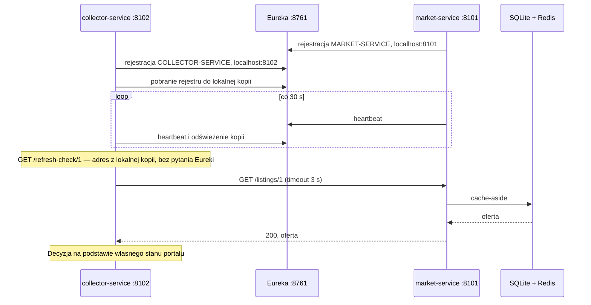

# Market Service — LAB1, LAB2 i LAB3

Pierwsza usługa projektu **„agregator i analizator ogłoszeń samochodowych”**. System zbiera oferty z portali ogłoszeniowych (otomoto.pl, autoscout24.de, autobazar.eu), sprowadza je do wspólnego modelu i śledzi zmiany cen, żeby dało się porównywać oferty i rynki różnych krajów.

Docelowy kształt systemu jest wzorowany na projekcie AutoRadar: podział na collector-service, market-service i alert-service, nazwy pól ofert, słownik paliw i tabele `listing` oraz `price_change`. Market Service jest rdzeniem systemu — przechowuje oferty i historię ich cen. Usługa działa na porcie **8101**, a oferty wprowadza się przez API; docelowo dostarczy je collector-service.

- **LAB1:** dane w pamięci procesu (sekcje 1–7).
- **LAB2:** dane w bazie SQLite przez SQLAlchemy, szczegóły oferty w cache Redis (cache-aside z TTL i unieważnianiem). Kontrakt API się nie zmienił. Zmiany, decyzje i dowody opisuje [sekcja 8](#8-lab2--baza-danych-i-cache).
- **LAB3:** rejestracja w Eurece jako `MARKET-SERVICE`. Druga usługa, [collector-service](../collector-service/README.md), odnajduje ją po nazwie. API, baza i cache się nie zmieniły. Opis i wyniki: [sekcja 9](#9-lab3--rejestracja-i-odnajdywanie-usług).

Odpowiedzi na pytania z części A instrukcji (przykład Locker Service): LAB1 — [czesc-a-locker-service.md](czesc-a-locker-service.md), LAB2 — [czesc-a-lab2-locker-service.md](czesc-a-lab2-locker-service.md), LAB3 — [czesc-a-lab3-locker-service.md](czesc-a-lab3-locker-service.md).

```
market-service/
├── app/
│   ├── main.py         # create_app(), lifespan (baza, Redis, Eureka), endpointy, dane początkowe, mapowanie błędów na HTTP
│   ├── eureka.py       # LAB3: klient rejestru z konfiguracji środowiska (z paczki LAB3)
│   ├── models.py       # modele Pydantic: kontrakt API i walidacja
│   ├── db_models.py    # LAB2: tabele listing i price_change (SQLAlchemy ORM)
│   ├── database.py     # LAB2: silnik i fabryka sesji (z paczki LAB2)
│   ├── repository.py   # LAB2: operacje na bazie i reguła biznesowa (zastąpił store.py z LAB1)
│   └── cache.py        # LAB2: JSON w Redis, TTL, timeouty i obsługa awarii (z paczki LAB2)
├── tests/
│   ├── conftest.py     # fixture: osobna baza w tmp_path i zamiennik Redis dla każdego testu
│   ├── memory_redis.py # zamiennik Redis z paczki LAB2
│   ├── fake_eureka.py  # LAB3: zamiennik klienta Eureki
│   ├── test_health.py
│   ├── test_listings.py       # testy API z LAB1
│   ├── test_storage_cache.py  # testy LAB2: trwałość, cache, awarie
│   └── test_eureka.py         # testy LAB3: cykl życia klienta rejestru
├── requests/           # treści żądań JSON do scenariusza ręcznego
├── requirements.txt
└── README.md
```

## Uruchomienie i testy

Wymagania: Python 3.12 lub nowszy (sprawdzono na 3.14.0), PowerShell, od LAB2 Redis — np. Docker Desktop, a od LAB3 Eureka Server ([sekcja 9.2](#92-konfiguracja-i-uruchomienie)). Testy automatyczne nie wymagają Redis ani Eureki. Otwórz terminal w katalogu `market-service`, w którym leży ten plik.

```powershell
python -m venv .venv
.\.venv\Scripts\python.exe -m pip install -r requirements.txt
.\.venv\Scripts\python.exe -m pytest -q

docker run --name lab2-redis -p 127.0.0.1:6379:6379 -d redis:7-alpine   # jeśli kontener istnieje: docker start lab2-redis
docker exec lab2-redis redis-cli ping                                    # PONG

$env:DATABASE_URL = 'sqlite:///./app.db'
$env:REDIS_URL = 'redis://localhost:6379/0'
$env:CACHE_PREFIX = 'lab2:mkotulski:market-service'
$env:CACHE_TTL_SECONDS = '60'
$env:EUREKA_SERVER_URL = 'http://127.0.0.1:8761'
$env:SERVICE_NAME = 'MARKET-SERVICE'
$env:SERVICE_PORT = '8101'
.\.venv\Scripts\python.exe -m uvicorn app.main:app --port 8101
```

Zmienne środowiskowe opisują [sekcja 8.2](#82-uruchomienie-i-konfiguracja) i [sekcja 9.2](#92-konfiguracja-i-uruchomienie). `CACHE_PREFIX` jest wymagany: bez niego aplikacja nie wystartuje.

W drugim terminalu:

```powershell
Invoke-RestMethod http://localhost:8101/health
```

```
status service
------ -------
ok     market-service
```

Dokumentacja API: [Swagger UI](http://localhost:8101/docs) i [ReDoc](http://localhost:8101/redoc). Serwer zatrzymuje się przez `Ctrl+C`. Nie trzeba aktywować środowiska. Jeśli port jest zajęty, czyli `Get-NetTCPConnection -LocalPort 8101 -State Listen` zwraca rekord, ustal, co go zajmuje. Port 8102 należy do collector-service. Inny port trzeba ustawić jednocześnie w `SERVICE_PORT` i `--port`, np. 8103, i zmienić go w poleceniach.

Od LAB3 usługę uruchamia się bez `--reload` (zalecenie instrukcji na czas eksperymentów z rejestrem). `--reload` restartuje proces po zapisaniu zmian w kodzie i nie przejmuje zmian zmiennych środowiskowych — po ich zmianie zatrzymaj Uvicorna i uruchom go ponownie. Na LAB1 restart kasował dane z pamięci (sekcja 4). Od LAB2 dane zostają w pliku `app.db`.

## 1. Problem i granice

### Problem i użytkownik

Osoba szukająca używanego samochodu przegląda kilka portali osobno, także zagranicznych, bo auto z Niemiec czy Słowacji bywa tańsze. Każdy portal ma inny format ogłoszeń, inne nazwy paliw i inną walutę. Ceny zmieniają się z dnia na dzień, a ogłoszenia znikają. Trudno więc porównać oferty tego samego modelu z różnych rynków i zauważyć obniżkę ceny.

Market Service przechowuje oferty z różnych portali w jednym modelu i przy każdej kolejnej obserwacji zapisuje aktualną cenę oraz jej historię.

Użytkownicy usługi:

- **osoba kupująca samochód** — przegląda oferty i historię ich cen;
- docelowo **collector-service** — dostarcza obserwacje ofert z portali;
- docelowo frontend i alert-service — odczytują oferty.

### Za co odpowiada usługa

- przechowywanie ofert z portali we wspólnym modelu: źródło, numer ogłoszenia w portalu, kraj, link do oryginału, marka, model, rocznik, przebieg, paliwo, cena i waluta;
- pilnowanie, by ta sama oferta portalu (źródło + numer ogłoszenia) była zapisana tylko raz;
- zapisywanie kolejnych obserwacji oferty (cena, przebieg) w poprawnej kolejności czasu i prowadzenie historii cen;
- lista ofert (z filtrem po marce, modelu i kraju) oraz szczegóły jednej oferty.

### Za co usługa nie odpowiada

- pobieranie stron portali, harmonogram i wybór wycinków rynku do pobierania — to collector-service;
- powiadomienia o nowych ofertach i obniżkach — to przyszły alert-service;
- dane osobowe sprzedawców, np. imię i telefon — nie są zapisywane w ogóle;
- kopie zdjęć i treści ogłoszeń — usługa przechowuje tylko link do oryginału;
- kupno, sprzedaż i płatności — usługa nie pośredniczy w transakcjach;
- konta użytkowników i logowanie.

Przeliczanie cen po kursach NBP, ocena ceny oferty, wykrywanie sprzedanych ofert i trendy to przyszłe funkcje *tej samej* usługi, a nie innych usług. Na LAB1 nie są realizowane.

### Pojęcia domenowe

- **Źródło (portal)** — serwis ogłoszeniowy, z którego pochodzi oferta: `otomoto` (PL), `autoscout24_de` (DE), `autobazar_eu` (SK, także oferty z CZ).
- **Oferta** — jedno ogłoszenie sprzedaży samochodu w danym źródle. W portalu ma numer `external_id`, a w usłudze — własny identyfikator `id`.
- **Obserwacja** — stan oferty (cena, przebieg) odczytany z portalu w konkretnej chwili `observed_at`.
- **Historia cen** — kolejne ceny oferty w czasie. Nowy punkt powstaje tylko wtedy, gdy cena się zmieniła.
- **Rynek** — oferty z jednego kraju. Porównanie tego samego modelu na różnych rynkach to cel przyszłej analizy.

### Dwie planowane usługi

| Planowana usługa | Odpowiedzialność | Własne dane | Operacje | Potrzebne informacje od innej usługi |
|---|---|---|---|---|
| Pierwsza — **market-service**, implementowana teraz (port 8101) | Wiedza o rynku: oferty z portali w jednym modelu i historia ich cen | Oferty: źródło, numer w portalu, kraj, link, tytuł, marka, model, rocznik, przebieg, paliwo, cena, waluta, czas pierwszej i ostatniej obserwacji, historia cen | Lista z filtrami, szczegóły, rejestracja nowej oferty, zapis nowszej obserwacji | Docelowo od collector-service: obserwacje ofert z portali. Na LAB1 — żadne; dane wprowadza się przez API |
| Druga — **collector-service**, od LAB3 w katalogu [collector-service](../collector-service/README.md) (port 8102; na razie stan portali) | Skąd i kiedy pobierać: wycinki rynku (segmenty) i uprzejme pobieranie list wyników z portali | Segmenty (marka, model, roczniki, portale), przebiegi pobierania, stan portali (np. wstrzymanie po serii odmów) | Konfiguracja segmentów, uruchamianie i odczyt przebiegów, stan portali | Do pobierania — żadne. Wynik pracy, czyli obserwacje ofert, przekazuje do market-service |

### Granice biznesowe i właściciel zapisu

- Oferty i historię cen zapisuje **wyłącznie market-service**, przez swoje API. Na LAB1 robi to klient API (ręcznie i w testach), docelowo — tylko collector-service. Frontend i alert-service mogą oferty jedynie odczytywać.
- Segmenty, przebiegi i stan portali zapisuje **wyłącznie collector-service**. Market-service nie przechowuje ich kopii; przy ofercie zna tylko identyfikator źródła (`source`).

Podział wynika z odpowiedzialności, nie z tabel:

- collector-service odpowiada na pytanie „skąd i kiedy pobierać”. Zmienia się, gdy portal zmieni układ strony albo zabezpieczenia. Jego praca to długie, celowo spowolnione przebiegi z limitem tempa i poszanowaniem robots.txt.
- market-service odpowiada na pytanie „co wiemy o rynku”. Jego model nie zależy od portalu, a zmienia się, gdy rosną potrzeby analizy: porównania, trendy, ocena ceny.

Każda z usług będzie mieć kilka tabel — w market-service np. oferty i zmiany cen, a później katalog modeli i kursy walut — i nadal pozostanie jedną usługą. Granicą jest odpowiedzialność, nie liczba tabel.

To także granica znaczenia pojęć, punkt wyjścia do bounded context. „Oferta” w collector-service to wpis z listy wyników odczytany w jednym przebiegu, czyli chwilowa migawka. W market-service to trwały byt z historią, który łączy wszystkie obserwacje tego samego ogłoszenia.

### Przyszłe wywołanie między usługami

To projekt kontraktu; komunikacja nie jest zaimplementowana na LAB1. Zaimplementowane na LAB3 wywołanie to inny, prostszy odczyt ([sekcja 9.3](#93-kontrakt-komunikacji-między-usługami)); opisany tu zapis obserwacji pozostaje planem.

- **Nadawca:** collector-service, po odczytaniu strony wyników z portalu.
- **Odbiorca:** market-service.
- **Metoda i ścieżka:** `POST /listings` dla oferty, której market-service jeszcze nie zna, np. `POST http://localhost:8101/listings`.
- **Żądanie:** treść jak w [requests/create-ok.json](requests/create-ok.json), czyli pola z sekcji 2. Dodatkowe pola collectora są pomijane.
- **Odpowiedź 201:** zapisana oferta z nadanym `id` (przykład w sekcji 3).
- **Odpowiedź 409:** `{"detail": "Listing otomoto/6123456789 already exists (listing 1)"}` — oferta jest już znana. Collector wysyła wtedy obserwację: `PATCH /listings/1` z polami `observed_at`, `price_amount` i `mileage_km`.
- **Odpowiedź 422:** dane z portalu nie spełniają kontraktu, np. brak ceny. Collector nie ponawia takiej obserwacji, tylko zapisuje błąd przebiegu.

**Zachowanie przy niedostępności market-service** (brak połączenia, timeout np. 5 s, odpowiedź 5xx):

- Collector nie gubi obserwacji: zachowuje je i ponawia wysyłkę z rosnącym odstępem.
- Pobieranie portali trwa dalej, bo nie zależy od market-service.
- Ponowienie jest bezpieczne: drugi `POST` tej samej oferty kończy się 409, a powtórzona obserwacja — 200 bez zmian (sekcja 2).
- Przebieg, którego obserwacji nie udało się dostarczyć, nie jest uznawany za kompletny.

Wysyłanie po jednej ofercie i ręczne ponowienia to koszt komunikacji synchronicznej. Dlatego na kolejnych laboratoriach to wywołanie zastąpi zdarzenie `listing.observed` w brokerze wiadomości — kolejka przechowa obserwacje, gdy market-service nie działa.

## 2. Model i reguła biznesowa

### Model `Listing`

| Pole | Typ JSON | Wymagane w `POST` | Ograniczenia | Kto nadaje |
|---|---|---|---|---|
| `id` | integer | — (pomijane) | kolejny numer: 1, 2, 3… (LAB1 — w instancji, od LAB2 — klucz główny w bazie, trwały) | serwer |
| `source` | string | tak | wzorzec `^[a-z0-9_]{2,40}$`, np. `otomoto` | klient |
| `external_id` | string | tak | 1–80 znaków; numer ogłoszenia w portalu | klient |
| `country` | string | tak | kod ISO 3166-1, wzorzec `^[A-Z]{2}$`, np. `PL` | klient |
| `url` | string (URL) | tak | adres http(s) oryginalnego ogłoszenia | klient |
| `title` | string | tak | 1–200 znaków po obcięciu spacji z brzegów | klient |
| `make` | string | tak | 1–60 znaków, np. `BMW` | klient |
| `model` | string | tak | 1–80 znaków, np. `Seria 3` | klient |
| `year` | integer | tak | 1950–2100 | klient |
| `mileage_km` | integer | tak | ≥ 0 | klient |
| `fuel` | string | tak | `petrol`, `diesel`, `hybrid`, `plugin_hybrid`, `electric`, `lpg`, `cng`, `hydrogen` albo `other` | klient |
| `price_amount` | integer | tak | > 0, w pełnych jednostkach waluty | klient |
| `currency` | string | tak | kod ISO 4217, wzorzec `^[A-Z]{3}$`, np. `PLN` | klient |
| `observed_at` | string, data i czas ISO 8601 | tak (tylko w żądaniu) | ze strefą czasową, np. `2026-10-21T08:00:00Z` | klient |
| `first_seen_at`, `last_seen_at` | string, data i czas | — | pierwsza i ostatnia obserwacja | serwer |
| `price_history` | lista `{at, amount}` | — | kolejne ceny; punkt dochodzi tylko przy zmianie ceny | serwer |

`PATCH /listings/{listing_id}` przyjmuje obserwację (`ListingObservation`):

- `observed_at` — wymagane, ze strefą czasową;
- `price_amount` — wymagane, > 0;
- `mileage_km` — opcjonalne, ≥ 0; brak oznacza, że przebieg się nie zmienił.

Decyzje projektowe:

- **Identyfikator `id` nadaje serwer** jako kolejny numer w instancji. Naturalnym kluczem oferty jest para `(source, external_id)` i to ona musi być unikalna (409 przy duplikacie). Krótki numer wygodniej podać w ścieżce i nie zależy on od formatu numerów w portalach. Odrzucona operacja nie zużywa numeru.
- **`external_id` jest tekstem**, bo portale stosują różne formaty: otomoto — liczby, AutoScout24 — GUID.
- **Czas ze strefą** ([`AwareDatetime`](https://pydantic.dev/docs/validation/latest/api/pydantic/types/#pydantic.types.AwareDatetime)). Obserwacje pochodzą z portali w różnych krajach, a czasu bez strefy nie da się z nimi jednoznacznie porównać, więc daje 422. Python nie porówna też czasu bez strefy z czasem ze strefą (`TypeError`, czyli błąd 500).
- **Cena jako liczba całkowita w walucie ogłoszenia.** Portale podają ceny w pełnych złotych czy euro, a liczba całkowita nie ma błędów zaokrągleń typu `float`. Przeliczania na PLN/EUR nie ma na LAB1.
- **Nieznane pola są pomijane** (`extra="ignore"`, wzorzec tolerant reader). Przyszły nadawca, collector-service, może dodać pole bez łamania kontraktu. Pola nadawane przez serwer (`id`, historia cen) nie należą do modelu wejściowego, więc klient ich nie ustawi. Dane spoza kontraktu, np. telefon sprzedawcy, nie są zapisywane (test `test_unknown_fields_are_ignored`).
- **Marka i model są zapisywane tak, jak przyszły.** Ujednolicanie nazw z różnych portali (np. „3er” i „Seria 3”) to przyszła funkcja: katalog modeli.
- **Modele.** Model domenowy `Listing` z historią cen (`PricePoint`) oraz dwa modele wejściowe: `ListingCreate` (`POST`) i `ListingObservation` (`PATCH`). Historia cen należy do oferty, więc nie ma osobnego zasobu.

Dane początkowe — na LAB1 każda nowa instancja aplikacji, także po restarcie procesu, startowała z trzech ofert. Od LAB2 trafiają one tylko do pustej bazy, przy pierwszym uruchomieniu:

| id | source | external_id | kraj | oferta | rocznik | przebieg | paliwo | cena | obserwacja (UTC) |
|---|---|---|---|---|---|---|---|---|---|
| 1 | otomoto | 6123456789 | PL | BMW Seria 3 320d xDrive M Sport | 2019 | 98 500 km | diesel | 104 900 PLN | 2026-10-20 08:00 |
| 2 | autoscout24_de | a8d3f1c2-0b5e-4c7a-9e21-5f6b7c8d9e01 | DE | BMW 320d Touring Luxury Line (BMW, Seria 3) | 2020 | 71 200 km | diesel | 22 400 EUR | 2026-10-20 09:00 |
| 3 | autobazar_eu | 198765432 | SK | Skoda Octavia Combi 2.0 TDI Style | 2018 | 142 000 km | diesel | 15 900 EUR | 2026-10-20 10:00 |

### Reguła biznesowa

**Stan oferty zmienia tylko obserwacja nowsza niż ostatnia.** Obserwacja (`PATCH /listings/{listing_id}`) jest przyjmowana, gdy jej `observed_at` jest późniejsze niż `last_seen_at` oferty. Wtedy:

- aktualna cena i przebieg przyjmują wartości z obserwacji, a `last_seen_at` — jej czas;
- jeśli cena się zmieniła, do `price_history` dochodzi nowy punkt;
- `first_seen_at` się nie zmienia.

Obserwacja starsza albo z tej samej chwili, ale z innymi danymi, jest odrzucana kodem **409**. Ponowne przesłanie dokładnie ostatniej obserwacji (ta sama chwila, cena i przebieg) jest dozwolone i niczego nie zmienia — tak działa np. ponowione żądanie po przekroczeniu czasu odpowiedzi.

**Po co ta reguła.** Obserwacje mogą przychodzić w innej kolejności, niż powstały: przy ponowieniach po awarii, z równoległych przebiegów albo przy ponownym przetwarzaniu zapisanych stron. Bez reguły spóźniona obserwacja nadpisałaby nowszą cenę i dopisała do historii fałszywą „zmianę ceny”. Na historii opierają się przyszłe analizy: obniżki i trendy.

- **Dozwolone:** `PATCH /listings/1` z [requests/observation-newer.json](requests/observation-newer.json): obserwacja z 2026-10-22 08:00 UTC, cena 99 900, przebieg 98 700. Ostatnia obserwacja oferty 1 jest z 2026-10-20, więc odpowiedź to **200**: cena 99 900, `last_seen_at` 2026-10-22, w historii dwa punkty (104 900 i 99 900).
- **Niedozwolone:** `PATCH /listings/1` z [requests/observation-older.json](requests/observation-older.json): obserwacja z 2026-10-19, czyli starsza niż ostatnia. Odpowiedź to **409**:

  ```json
  {"detail": "Observation from 2026-10-19T08:00:00+00:00 is not newer than the last observation of listing 1 (2026-10-20T08:00:00+00:00)"}
  ```

  Oferta pozostaje bez zmian.

**Dlaczego 409, a nie 422.** Treść obserwacji jest poprawna: ta sama obserwacja zostałaby przyjęta przez ofertę, której ostatnia obserwacja jest starsza. O odrzuceniu decyduje aktualny stan danych, czyli czas ostatniej obserwacji. Kod 422 oznacza dane błędne niezależnie od stanu, np. czas bez strefy albo cenę 0.

Drugi rodzaj konfliktu to **duplikat oferty**. `POST /listings` z parą `(source, external_id)`, która już istnieje, daje 409: `{"detail": "Listing otomoto/6123456789 already exists (listing 1)"}`. Ten sam numer ogłoszenia w innym portalu to inna oferta (201). To ograniczenie unikalności klucza, a nie główna reguła biznesowa.

### Warunki odrzucenia są sprawdzane przed zmianą stanu

1. FastAPI waliduje treść żądania i parametr ścieżki, zanim wywoła endpoint. Przy 422 kod magazynu w ogóle się nie wykonuje.
2. LAB1: `ListingStore.create` najpierw szukał duplikatu `(source, external_id)`, a dopiero potem zwiększał licznik i zapisywał ofertę. LAB2: `ListingRepository.create` robi to samo wewnątrz transakcji; dodatkowo chroni to ograniczenie `UNIQUE(source, external_id)` w bazie (sekcja 8.1).
3. LAB1: `ListingStore.record_observation` najpierw odczytywał ofertę (404) i sprawdzał regułę (409), potem podmieniał ją jednym przypisaniem. LAB2: `ListingRepository.record_observation` ma tę samą kolejność w jednej transakcji: odczyt → reguła → zmiana → commit. Odrzucenie przerywa transakcję przed zmianą, a wyjątek wycofuje ją w całości, więc nie istnieje stan „w połowie zmiany”.

Testy porównują pełny stan przed i po każdej odrzuconej operacji.

## 3. Kontrakt API

| Metoda | Ścieżka | Znaczenie | Sukces | Błędy |
|---|---|---|---|---|
| GET | `/health` | Status i nazwa usługi, bez danych domenowych | 200 | — |
| GET | `/ready` | LAB2, rozszerzenie: gotowość — stan bazy i cache | 200 (`ok` albo `degraded` bez Redis) | 503 — baza niedostępna |
| GET | `/listings` | Lista ofert w kolejności zapisu; opcjonalne filtry `?make=BMW`, `?model=Seria 3`, `?country=PL` (dokładna zgodność) | 200, również `[]` | — |
| GET | `/listings/{listing_id}` | Szczegóły oferty z historią cen. Od LAB2 nagłówek `X-Cache`: `MISS`, `HIT` albo `BYPASS` | 200 | 404; 422 — identyfikator nie jest liczbą |
| POST | `/listings` | Rejestracja nowej oferty z portalu | 201 | 409 — oferta z tego źródła już istnieje; 422 — błędne dane |
| PATCH | `/listings/{listing_id}` | Zapis nowszej obserwacji: aktualna cena i przebieg | 200 | 404; 409 — obserwacja nie jest nowsza; 422 — błędne dane |

Uzasadnienie kodów:

- **200 OK** — odczyt albo zmiana się udały; odpowiedź zawiera aktualny stan oferty. Ponowione przesłanie ostatniej obserwacji też zwraca 200: stan docelowy jest już osiągnięty.
- **201 Created** — `POST` utworzył nową ofertę; odpowiedź zawiera nadane `id`, czasy obserwacji i historię cen.
- **404 Not Found** — brak oferty o identyfikatorze ze ścieżki. Filtr listy, który nic nie znajduje, zwraca **200 i `[]`**: kolekcja istnieje, jest tylko pusta.
- **409 Conflict** — żądanie jest poprawne, ale koliduje z aktualnym stanem: oferta z tego źródła już istnieje albo obserwacja nie jest nowsza niż ostatnia.
- **422 Unprocessable Content** (dawniej „Unprocessable Entity”) — dane nie spełniają kontraktu niezależnie od stanu: zły typ, brak pola, przekroczony zakres, niezgodny wzorzec, nieznane paliwo, zły adres URL, czas bez strefy albo identyfikator w ścieżce, który nie jest liczbą.

**Dlaczego `PATCH`, a nie `PUT` lub `POST`.** Obserwacja zmienia tylko część pól istniejącej oferty: cenę, przebieg i czas ostatniej obserwacji. Nie zastępuje całej oferty (to robiłby `PUT`) i nie tworzy nowego zasobu (to robi `POST`).

Są dwa formaty błędów:

- **404 i 409** (`HTTPException`): `{"detail": "opis"}`, czyli jeden tekst.
- **422** (walidacja FastAPI, `RequestValidationError`): `{"detail": [ ... ]}`, czyli lista obiektów:
  - `loc` — miejsce błędu, np. `["body", "price_amount"]` albo `["path", "listing_id"]`;
  - `msg` — przyczyna;
  - `type` — kod błędu;
  - `input` — odrzucona wartość;
  - `ctx` — parametry ograniczenia (gdy występuje).

  Jedno żądanie może zgłosić kilka błędów naraz.

Pełne schematy, ograniczenia pól i przykładowe żądanie są w `/docs`.

### Przykłady żądań i odpowiedzi

Odpowiedzi poniżej to rzeczywiste wyniki z działającej usługi (sekcja 4). Długie odpowiedzi są tylko sformatowane w kilku liniach; ich treść się nie zmieniła.

Wskazówki do poleceń w PowerShellu:

- Używaj `curl.exe`, nie aliasu `curl`.
- Ścieżkę do pliku z treścią podawaj w cudzysłowie: `"@requests/…"`. Bez cudzysłowu znak `@` jest operatorem PowerShella.
- Adres z kilkoma parametrami (`&`) też ujmij w cudzysłów.
- Treści żądań leżą w plikach w `requests/`. Dzięki temu nie trzeba wpisywać JSON-a w poleceniu, a PowerShell 5.1 usuwa z niego cudzysłowy.

**Rejestracja oferty — 201**

```powershell
curl.exe -i -X POST -H "Content-Type: application/json" --data-binary "@requests/create-ok.json" http://localhost:8101/listings
```

Treść żądania ([requests/create-ok.json](requests/create-ok.json)):

```json
{
  "source": "otomoto",
  "external_id": "6123456790",
  "country": "PL",
  "url": "https://www.otomoto.pl/osobowe/oferta/bmw-seria-3-ID6123456790.html",
  "title": "BMW Seria 3 320i Sport Line",
  "make": "BMW",
  "model": "Seria 3",
  "year": 2021,
  "mileage_km": 45000,
  "fuel": "petrol",
  "price_amount": 129900,
  "currency": "PLN",
  "observed_at": "2026-10-21T08:00:00Z"
}
```

Odpowiedź `HTTP/1.1 201 Created`:

```json
{
  "id": 4,
  "source": "otomoto",
  "external_id": "6123456790",
  "country": "PL",
  "url": "https://www.otomoto.pl/osobowe/oferta/bmw-seria-3-ID6123456790.html",
  "title": "BMW Seria 3 320i Sport Line",
  "make": "BMW",
  "model": "Seria 3",
  "year": 2021,
  "mileage_km": 45000,
  "fuel": "petrol",
  "price_amount": 129900,
  "currency": "PLN",
  "first_seen_at": "2026-10-21T08:00:00Z",
  "last_seen_at": "2026-10-21T08:00:00Z",
  "price_history": [{"at": "2026-10-21T08:00:00Z", "amount": 129900}]
}
```

To samo w PowerShellu bez pliku. To polecenie pokazuje treść odpowiedzi, ale nie status:

```powershell
$body = @{ source = 'otomoto'; external_id = '6123456790'; country = 'PL'; url = 'https://www.otomoto.pl/osobowe/oferta/bmw-seria-3-ID6123456790.html'; title = 'BMW Seria 3 320i Sport Line'; make = 'BMW'; model = 'Seria 3'; year = 2021; mileage_km = 45000; fuel = 'petrol'; price_amount = 129900; currency = 'PLN'; observed_at = '2026-10-21T08:00:00Z' } | ConvertTo-Json
Invoke-RestMethod -Method Post -Uri http://localhost:8101/listings -ContentType 'application/json' -Body $body
```

**Szczegóły — 200**

`curl.exe -i http://localhost:8101/listings/4` zwraca tę samą treść, co odpowiedź na `POST`.

**Lista z filtrem — 200**

`curl.exe -i "http://localhost:8101/listings?make=BMW&model=Seria%203"` zwraca oferty 1 i 2 (PL i DE). Filtr bez wyników, `curl.exe -i "http://localhost:8101/listings?make=Audi"`:

```json
[]
```

**Brak zasobu — 404**

`curl.exe -i http://localhost:8101/listings/999`:

```json
{"detail":"Listing 999 not found"}
```

**Identyfikator, który nie jest liczbą — 422**

`curl.exe -i http://localhost:8101/listings/abc`:

```json
{"detail":[{"type":"int_parsing","loc":["path","listing_id"],"msg":"Input should be a valid integer, unable to parse string as an integer","input":"abc"}]}
```

**Duplikat oferty — 409**

Treść: [requests/create-duplicate.json](requests/create-duplicate.json) — oferta otomoto/6123456789, czyli oferta 1, z inną ceną.

```powershell
curl.exe -i -X POST -H "Content-Type: application/json" --data-binary "@requests/create-duplicate.json" http://localhost:8101/listings
```

```json
{"detail":"Listing otomoto/6123456789 already exists (listing 1)"}
```

**Błędne dane — 422**

Treść: [requests/create-invalid.json](requests/create-invalid.json) — kraj `pl`, przebieg −1 i czas bez strefy.

```powershell
curl.exe -i -X POST -H "Content-Type: application/json" --data-binary "@requests/create-invalid.json" http://localhost:8101/listings
```

```json
{"detail":[
  {"type":"string_pattern_mismatch","loc":["body","country"],"msg":"String should match pattern '^[A-Z]{2}$'","input":"pl","ctx":{"pattern":"^[A-Z]{2}$"}},
  {"type":"greater_than_equal","loc":["body","mileage_km"],"msg":"Input should be greater than or equal to 0","input":-1,"ctx":{"ge":0}},
  {"type":"timezone_aware","loc":["body","observed_at"],"msg":"Input should have timezone info","input":"2026-10-21T08:00:00"}
]}
```

Inne odpowiedzi 422 (sprawdzane w testach):

| Żądanie `POST /listings` | `type` | `loc` | `msg` |
|---|---|---|---|
| `"year": 1949` | `greater_than_equal` | `["body","year"]` | `Input should be greater than or equal to 1950` |
| `"price_amount": 0` | `greater_than` | `["body","price_amount"]` | `Input should be greater than 0` |
| `"currency": "zł"` | `string_pattern_mismatch` | `["body","currency"]` | `String should match pattern '^[A-Z]{3}$'` |
| `"fuel": "gas"` | `enum` | `["body","fuel"]` | `Input should be 'petrol', 'diesel', 'hybrid', 'plugin_hybrid', 'electric', 'lpg', 'cng', 'hydrogen' or 'other'` |
| `"url": "otomoto.pl/oferta"` | `url_parsing` | `["body","url"]` | `Input should be a valid URL, relative URL without a base` |
| `"title": "   "` | `string_too_short` | `["body","title"]` | `String should have at least 1 character` |
| brak pola `make` | `missing` | `["body","make"]` | `Field required` |

**Nowsza obserwacja — 200**

Treść: [requests/observation-newer.json](requests/observation-newer.json), czyli `{"observed_at": "2026-10-22T08:00:00Z", "price_amount": 99900, "mileage_km": 98700}`.

```powershell
curl.exe -i -X PATCH -H "Content-Type: application/json" --data-binary "@requests/observation-newer.json" http://localhost:8101/listings/1
```

Odpowiedź — wybrane pola:

```json
{
  "id": 1,
  "mileage_km": 98700,
  "price_amount": 99900,
  "first_seen_at": "2026-10-20T08:00:00Z",
  "last_seen_at": "2026-10-22T08:00:00Z",
  "price_history": [
    {"at": "2026-10-20T08:00:00Z", "amount": 104900},
    {"at": "2026-10-22T08:00:00Z", "amount": 99900}
  ]
}
```

To samo przez `Invoke-RestMethod`:

```powershell
$body = @{ observed_at = '2026-10-22T08:00:00Z'; price_amount = 99900; mileage_km = 98700 } | ConvertTo-Json
Invoke-RestMethod -Method Patch -Uri http://localhost:8101/listings/1 -ContentType 'application/json' -Body $body
```

**Starsza obserwacja — 409**

Treść: [requests/observation-older.json](requests/observation-older.json), czyli `{"observed_at": "2026-10-19T08:00:00Z", "price_amount": 109900}`. Wysłana po poprzednim kroku, gdy ostatnia obserwacja oferty jest już z 2026-10-22:

```json
{"detail":"Observation from 2026-10-19T08:00:00+00:00 is not newer than the last observation of listing 1 (2026-10-22T08:00:00+00:00)"}
```

**Błędna obserwacja — 422**

Treść: [requests/observation-invalid.json](requests/observation-invalid.json), czyli `{"observed_at": "2026-10-23T08:00:00", "price_amount": 0}`.

```json
{"detail":[
  {"type":"timezone_aware","loc":["body","observed_at"],"msg":"Input should have timezone info","input":"2026-10-23T08:00:00"},
  {"type":"greater_than","loc":["body","price_amount"],"msg":"Input should be greater than 0","input":0,"ctx":{"gt":0}}
]}
```

## 4. Testy i stan danych

> Ta sekcja opisuje wyniki **LAB1** (dane w pamięci). Wszystkie testy API z LAB1 zostały zachowane i przechodzą na LAB2 z bazą. Zmiany w testach, nowe testy i wyniki LAB2 są w [sekcji 8.3](#83-testy-automatyczne).

### Testy automatyczne

Każdy test dostaje własną aplikację z fixture `client` ([tests/conftest.py](tests/conftest.py)). Na LAB1 `TestClient(create_app())` tworzył nowy `ListingStore` z trzema ofertami początkowymi, więc testy nie zależały od kolejności uruchomienia. Od LAB2 fixture podaje osobny plik bazy w `tmp_path` i nowy zamiennik Redis. `TestClient` nie wymaga działającego Uvicorna. Po każdej odrzuconej operacji testy porównują pełny stan z tym sprzed żądania.

Wszystkie testy oprócz `test_health` są w pliku [tests/test_listings.py](tests/test_listings.py).

| Test | Co wykazuje |
|---|---|
| `test_health` ([tests/test_health.py](tests/test_health.py)) | 200 i nazwa `market-service`. To test startowy, nie liczy się do minimum |
| `test_list_and_details_return_initial_listings` | 200, lista ofert 1–3, wszystkie pola oferty 1 |
| `test_filtered_list_may_be_empty` | Filtry `make` z `model` oraz `country`; brak wyników to 200 i `[]`, nie 404 |
| `test_unknown_listing_returns_404` | 404 i `detail` dla `GET` i `PATCH` |
| `test_non_numeric_listing_id_returns_422` | `GET /listings/abc` → 422 z `loc: ["path","listing_id"]` |
| `test_create_then_read` | **Zapis → odczyt**: 201, `id` 4, `first_seen_at` = `last_seen_at` = `observed_at`, historia z jednym punktem; osobny `GET` zwraca to samo, lista ma 4 oferty |
| `test_invalid_listing_returns_422_and_does_not_change_state` (9 przypadków) | **Błędne dane bez zmiany stanu.** Przypadki: rocznik 1949, przebieg −1, cena 0, kraj `pl`, waluta `zł`, paliwo `gas`, adres bez `http`, pusty tytuł, czas bez strefy. Każdy daje 422 z `loc` wskazującym dokładnie to pole, a lista się nie zmienia |
| `test_unknown_fields_are_ignored` | Nadmiarowe pola są pomijane: przesłane `id: 77` nie działa (serwer nadaje 4), a `seller_phone` nie jest zapisywany |
| `test_duplicate_listing_returns_409_and_does_not_change_state` | **Konflikt bez zmiany stanu**: duplikat otomoto/6123456789 → 409, lista bez zmian; następna nowa oferta nadal dostaje `id` 4 |
| `test_same_external_id_in_another_source_is_another_listing` | Klucz unikalności to para `(source, external_id)`: ten sam numer w innym portalu → 201 |
| `test_newer_observation_updates_price_and_history` | **Reguła (dozwolone) i zapis → odczyt**: 200, nowa cena i przebieg, nowe `last_seen_at`, drugi punkt historii, `first_seen_at` bez zmian; osobny `GET` to potwierdza |
| `test_newer_observation_with_the_same_price_keeps_history` | Nowsza obserwacja z tą samą ceną zmienia `last_seen_at`, ale nie historię; brak przebiegu w obserwacji nie zmienia przebiegu |
| `test_older_observation_returns_409_and_does_not_change_state` | **Reguła (niedozwolone)**: 409 z opisem, oferta bez zmian |
| `test_repeated_last_observation_changes_nothing` | Ponowiona ostatnia obserwacja → 200 bez zmian; ta sama chwila z inną ceną → 409, oferta bez zmian |
| `test_invalid_observation_returns_422_and_does_not_change_state` (4 przypadki) | Czas bez strefy, cena 0, przebieg −5, brak `observed_at` → 422, oferta bez zmian |
| `test_each_application_has_its_own_store` (od LAB2: `test_each_database_has_its_own_listings`) | Dwie instancje `create_app()` nie współdzielą danych; od LAB2 — dwie instancje z różnymi plikami bazy |

Wynik polecenia ze wstępu (2026-10-25, Windows 10, Python 3.14.0):

```
PS> .\.venv\Scripts\python.exe -m pytest -q
...........................                                              [100%]
============================== warnings summary ===============================
.venv\Lib\site-packages\starlette\testclient.py:51
  DeprecationWarning: The anyio.abc.BlockingPortal alias is deprecated, use anyio.from_thread.BlockingPortal instead.
27 passed, 1 warning in 0.85s
```

27 testów to 1 test startowy i 26 własnych przypadków. Ostrzeżenie pochodzi z biblioteki Starlette i nowszej biblioteki `anyio`; Starlette jest w wersji 0.47, którą wymusza `requirements.txt`. Nie dotyczy kodu usługi ani wyników. Instalacja od zera w nowym środowisku dała ten sam wynik.

Skuteczność testów sprawdzono na kopii kodu z celowo wprowadzonymi błędami. Każdy z 9 błędów wykrył co najmniej jeden test:

- obserwacja z tej samej chwili z inną ceną przyjmowana;
- powtórzona ostatnia obserwacja traktowana jako konflikt;
- punkt historii dopisywany mimo tej samej ceny;
- numer zużywany przed sprawdzeniem duplikatu;
- duplikat sprawdzany bez źródła;
- zmiana stanu przed sprawdzeniem reguły;
- `first_seen_at` nadpisywane przez obserwację;
- czas bez strefy przyjmowany przy tworzeniu oferty;
- 422 zamiast 409 przy starszej obserwacji.

### Scenariusze i wyniki

| Scenariusz | Stan początkowy i dokładne żądanie | Oczekiwany status, treść i stan | Wynik rzeczywisty | Reset danych |
|---|---|---|---|---|
| Health | Dowolny; `GET /health` | 200, `{"status":"ok","service":"market-service"}` | Zgodny: `test_health` passed; krok 1 ręcznie: 200 | Nie zmienia danych |
| Lista i szczegóły | Dane początkowe; `GET /listings`, `GET /listings/1` | 200, oferty 1–3; szczegóły oferty 1: otomoto, BMW Seria 3, 104 900 PLN | Zgodny: test passed; krok 2 ręcznie: 200 | Nie zmienia danych |
| Zapis → odczyt | Dane początkowe; `POST /listings` z `create-ok.json`, potem `GET /listings/4` | 201 z `id: 4`; `GET` 200 z tymi samymi danymi | Zgodny: `test_create_then_read` passed; kroki 5–6 ręcznie: 201, potem 200 | Testy: nowa aplikacja; ręcznie: restart Uvicorna |
| Brak zasobu | Dane początkowe; `GET /listings/999` | 404, `{"detail":"Listing 999 not found"}` | Zgodny: test passed; krok 4 ręcznie: 404 | Nie zmienia danych |
| Błędne dane | Dane początkowe, w scenariuszu ręcznym także oferta 4; `POST` z `create-invalid.json` | 422, `detail` wskazuje `country`, `mileage_km` i `observed_at`; brak nowej oferty | Zgodny: 9 przypadków passed; krok 8 ręcznie: 422, `GET /listings?make=Audi` nadal `[]` | Nie zmienia danych |
| Konflikt | Oferta 1 = otomoto/6123456789; `POST` z `create-duplicate.json` | 409, `detail` wskazuje ofertę 1; oferta 1 bez zmian (104 900 PLN) | Zgodny: test passed; krok 7 ręcznie: 409, oferta 1 bez zmian | Nie zmienia danych |
| Reguła biznesowa: dozwolona i niedozwolona operacja | Oferta 1 z ostatnią obserwacją z 2026-10-20. Dozwolone: `PATCH /listings/1` z `observation-newer.json`. Niedozwolone: `PATCH /listings/1` z `observation-older.json` | Dozwolone → 200, cena 99 900, dwa punkty historii. Niedozwolone → 409, oferta bez zmian | Zgodny: testy reguły passed. Ręcznie: krok 9 — 200, krok 10 — 409 i bez zmian, krok 11 — powtórka 200 bez zmian | Testy: nowa aplikacja; ręcznie: restart |
| Restart | Po krokach 1–12: istnieje oferta 4, oferta 1 ma cenę 99 900 i dwa punkty historii. Zatrzymanie i ponowne uruchomienie Uvicorna, potem `GET` | Oferta 4 → 404, oferta 1 znów 104 900 PLN z jednym punktem historii, lista = dane początkowe | Zgodny, szczegóły niżej | Restart sam przywraca dane początkowe |

### Scenariusz ręczny przez HTTP

Scenariusz wykonano 2026-10-25 na działającym Uvicornie (`.\.venv\Scripts\python.exe -m uvicorn app.main:app --port 8101`), z drugiego terminala przez `curl.exe`. Wszystkie kroki da się powtórzyć w `/docs`. Ścieżki plików są względne do katalogu `market-service`.

| Krok | Żądanie | Oczekiwany wynik | Wynik rzeczywisty |
|---|---|---|---|
| 1 | `GET /health` | 200, status i nazwa usługi | 200 `{"status":"ok","service":"market-service"}` |
| 2 | `GET /listings`, `GET /listings/1` | 200, trzy oferty; szczegóły oferty 1 | 200, oferty 1–3; 200, otomoto, 104 900 PLN, jeden punkt historii |
| 3 | `GET /listings?make=BMW&model=Seria%203`, `GET /listings?make=Audi` | 200 z ofertami 1 i 2; 200 i `[]` | 200, oferty 1 (PL) i 2 (DE); 200 `[]` |
| 4 | `GET /listings/999`, `GET /listings/abc` | 404 z opisem; 422 dla ścieżki | 404 `{"detail":"Listing 999 not found"}`; 422 `int_parsing`, `loc: ["path","listing_id"]` |
| 5 | `POST /listings`, `create-ok.json` | 201, oferta 4 | 201, `id: 4`, `first_seen_at` = `last_seen_at` = 2026-10-21T08:00:00Z |
| 6 | `GET /listings/4` | 200, dane z kroku 5 | 200, identyczne dane |
| 7 | `POST /listings`, `create-duplicate.json`; potem `GET /listings/1` | 409; oferta 1 bez zmian | 409 (oferta 1 już istnieje); oferta 1 nadal 104 900 PLN |
| 8 | `POST /listings`, `create-invalid.json`; potem `GET /listings?make=Audi` | 422 dla trzech pól; oferta nie powstaje | 422 z trzema błędami; `[]` |
| 9 | `PATCH /listings/1`, `observation-newer.json`; potem `GET /listings/1` | 200; cena 99 900, dwa punkty historii w obu odpowiedziach | 200 i `GET` 200: cena 99 900, przebieg 98 700, `last_seen_at` 2026-10-22T08:00:00Z, dwa punkty historii |
| 10 | `PATCH /listings/1`, `observation-older.json`; potem `GET /listings/1` | 409; oferta bez zmian | 409 (ostatnia obserwacja z 2026-10-22); oferta bez zmian |
| 11 | Ponownie `PATCH /listings/1`, `observation-newer.json`; potem `GET` | 200 bez zmian — to ta sama obserwacja | 200; nadal dwa punkty historii |
| 12 | `PATCH /listings/1`, `observation-invalid.json`; potem `GET` | 422; oferta bez zmian | 422 (`timezone_aware`, `greater_than`); oferta bez zmian |
| 13 | Zatrzymanie Uvicorna i ponowne uruchomienie tym samym poleceniem | Nowy proces z nowym magazynem | Nowy proces nasłuchuje na 8101 |
| 14 | `GET /listings/4`, `GET /listings/1`, `GET /listings` | 404; oferta 1 z danymi początkowymi; tylko oferty 1–3 | 404; 104 900 PLN, `last_seen_at` 2026-10-20T08:00:00Z, jeden punkt historii; oferty 1–3 |

Fragment logu Uvicorna z pierwszego uruchomienia potwierdza kody odpowiedzi:

```
INFO:     Uvicorn running on http://127.0.0.1:8101 (Press CTRL+C to quit)
INFO:     127.0.0.1:53871 - "GET /listings/999 HTTP/1.1" 404 Not Found
INFO:     127.0.0.1:53873 - "GET /listings/abc HTTP/1.1" 422 Unprocessable Content
INFO:     127.0.0.1:53875 - "POST /listings HTTP/1.1" 201 Created
INFO:     127.0.0.1:53879 - "POST /listings HTTP/1.1" 409 Conflict
INFO:     127.0.0.1:53883 - "POST /listings HTTP/1.1" 422 Unprocessable Content
INFO:     127.0.0.1:53888 - "PATCH /listings/1 HTTP/1.1" 200 OK
INFO:     127.0.0.1:53893 - "PATCH /listings/1 HTTP/1.1" 409 Conflict
INFO:     127.0.0.1:53897 - "PATCH /listings/1 HTTP/1.1" 200 OK
INFO:     127.0.0.1:53902 - "PATCH /listings/1 HTTP/1.1" 422 Unprocessable Content
```

Port sprawdzono trzema sposobami: komunikatem Uvicorna (powyżej), odpowiedzią `/health` oraz poleceniem pokazującym proces nasłuchujący:

```
PS> Get-NetTCPConnection -LocalPort 8101 -State Listen | Format-Table LocalAddress, LocalPort, State, OwningProcess
LocalAddress LocalPort  State OwningProcess
------------ ---------  ----- -------------
127.0.0.1         8101 Listen          7956

PS> Get-Process -Id 7956 | Format-Table Id, ProcessName
  Id ProcessName
  -- -----------
7956 python
```

### Eksperyment z restartem

Uvicorna uruchomiono **bez `--reload`** i nie zmieniano kodu, żeby wykluczyć dodatkowy restart.

1. Kroki 5–12 utworzyły ofertę 4 i zmieniły cenę oferty 1 na 99 900 (dwa punkty historii). Każdą zmianę potwierdził osobny `GET`.
2. Proces zatrzymano (w terminalu: `Ctrl+C`). Następnie `Get-NetTCPConnection -LocalPort 8101 -State Listen` nie zwrócił żadnego rekordu, a `Invoke-RestMethod http://localhost:8101/health` zakończył się błędem połączenia.
3. Uvicorna uruchomiono ponownie tym samym poleceniem.

Wynik po restarcie:

```
GET /listings/4                      -> 404 {"detail":"Listing 4 not found"}
GET /listings/1                      -> 200 cena 104900 PLN, last_seen_at 2026-10-20T08:00:00Z, 1 punkt historii
GET /listings                        -> 200 oferty 1, 2, 3 (każda z 1 punktem historii)
PATCH /listings/1 (obserwacja z 19.10) -> 409, teraz względem obserwacji z 2026-10-20 — tej z 22.10 już nie ma
POST create-ok.json                  -> 201 {"id": 4, ...}  (ten sam numer nadany ponownie)
```

**Dlaczego dane przetrwały między żądaniami, ale nie restart.** Uvicorn przy starcie importuje `app.main`, a wtedy `create_app()` raz tworzy obiekt `ListingStore` i zapisuje go w `app.state.listings`. Wszystkie żądania obsługuje ten sam proces i ten sam obiekt w jego pamięci, więc zmiana z `POST` albo `PATCH` jest widoczna w następnym `GET`.

Zatrzymanie procesu zwalnia jego pamięć, a dane nie są nigdzie zapisywane — nie ma pliku ani bazy. Nowy proces ponownie wywołuje `create_app()`: powstaje pusty magazyn, do którego trafiają tylko oferty początkowe. Historia cen sprzed restartu przepada, a licznik numerów zaczyna od nowa, stąd ponowne `id` 4.

`--reload` działa tak samo, bo po zapisaniu pliku restartuje proces. Trwałe dane przyniesie baza na LAB2; dla agregatora to warunek konieczny, bo historia cen jest jego głównym zasobem.

## 5. Porównanie architektur

Ten sam system — pobieranie ofert z portali, oferty z historią cen i powiadomienia — w trzech wariantach.

**Monolit**

```
                       Klient (przeglądarka)
                                 │ HTTP
                                 ▼
┌───────────── jeden proces: aplikacja „agregator ogłoszeń” ─────────────┐
│                                                                        │
│   pobieranie portali ── wywołanie w kodzie ──► oferty i historia cen   │
│                                                      │                 │
│                                                      │ wywołanie       │
│                                                      ▼ w kodzie        │
│                                                powiadomienia           │
│                                                                        │
│   brak granic modułów: każdy fragment kodu czyta i zmienia             │
│   dowolne tabele                                                       │
└───────────────────────────────────┬────────────────────────────────────┘
                                    ▼
                       jedna wspólna baza danych
           (segmenty, oferty, historia cen, obserwowane razem)
```

**Modularny monolit**

```
                                    Klient
                                      │ HTTP
                                      ▼
┌─────────────── jeden proces: jedna aplikacja, jedno wdrożenie ────────────────┐
│                                                                               │
│  ┌─ moduł pobierania ──────┐   wywołanie    ┌─ moduł rynku ─────────────────┐ │
│  │ segmenty, portale       │ ─────────────► │ record_observation()          │ │
│  │ zapisuje segmenty       │    w kodzie    │ zapisuje oferty i ceny        │ │
│  └────────────┬────────────┘                └───────┬───────────────┬───────┘ │
│               │                                     │ wywołanie     │         │
│               │                                     ▼ w kodzie      │         │
│               │                       ┌─ moduł powiadomień ─┐       │         │
│               │                       └──────────┬──────────┘       │         │
└───────────────┼──────────────────────────────────┼──────────────────┼─────────┘
                ▼                                  ▼                  ▼
┌────────────────────────────────── jedna baza danych ──────────────────────────┐
│  tabele segmentów        tabele obserwowanych         tabele ofert i cen      │
│  (pisze tylko moduł      (pisze tylko moduł           (pisze tylko moduł      │
│  pobierania)             powiadomień)                 rynku)                  │
└───────────────────────────────────────────────────────────────────────────────┘
```

**Mikrousługi**

```
                               Klient (przeglądarka)
                                         │ HTTP
                                         ▼
                         API Gateway (kolejne laboratoria)
                         HTTP │                     │ HTTP
                              ▼                     ▼
┌─ collector-service ───────────────┐       ┌─ market-service ──────────────────┐
│ osobny proces, port 8102          │ HTTP  │ osobny proces, port 8101          │
│ segmenty i pobieranie portali     │ ────► │ oferty i historia cen             │
│ jedyny zapis segmentów            │  (1)  │ jedyny zapis ofert                │
└────────┬───────────────┬──────────┘       └─────────────────┬─────────────────┘
         │               ▼                                    ▼
         │      dane segmentów                       dane ofert i cen
         │      i przebiegów                         (LAB1: pamięć procesu,
         │      (własna baza)                         LAB2: własna baza)
         ▼ HTTP (robots.txt, limit tempa)
  portale: otomoto.pl, autoscout24.de, autobazar.eu
```

(1) `POST /listings` i `PATCH /listings/{listing_id}` — przyszłe wywołanie opisane w sekcji 1. Docelowo zastąpi je zdarzenie `listing.observed` w brokerze wiadomości. Trzecia usługa, alert-service, będzie pobierać szczegóły ofert przez `GET /listings/{listing_id}`.

| Pytanie | Monolit | Modularny monolit | Mikrousługi |
|---|---|---|---|
| Czy wszystkie funkcje są wdrażane razem? | Tak | Tak | Nie — collector-service i market-service osobno |
| Czy części komunikują się przez sieć? | Nie, wywołania w kodzie | Nie, wywołania modułów | Tak, HTTP; później także broker zdarzeń |
| Czy działają w osobnych procesach? | Nie, jeden proces | Nie, jeden proces | Tak, każda usługa we własnym procesie i na własnym porcie |
| Czy awaria procesu może objąć cały system? | Tak | Tak | Wyłącza jedną usługę, ale skutki dotkną zależnych operacji: bez market-service nowe obserwacje czekają w collectorze |
| Czy dane mogą być rozdzielone? | Zwykle wspólne tabele | Logicznie — każdy moduł pisze tylko swoje tabele | Tak, każda usługa ma własne dane |
| Czy wdrożenie jest niezależne? | Nie | Nie | Tak |

Odpowiedzi na pytania z sekcji 6 instrukcji:

1. **Dlaczego market-service może być mikrousługą?**
   - Ma jedną spójną odpowiedzialność: wiedzę o ofertach i ich cenach, niezależną od portalu, z którego pochodzą.
   - Jest jedynym właścicielem i jedynym miejscem zapisu ofert i historii cen.
   - Udostępnia kontrakt HTTP i działa jako osobny proces na własnym porcie.
   - Da się ją wdrożyć i zrestartować niezależnie od pobierania: collector w tym czasie przechowa obserwacje i ponowi wysyłkę.
   - Regułę kolejności obserwacji sprawdza na własnych danych, bez pytania innej usługi.
2. **Dlaczego nie jest tylko klasą albo modułem?** `ListingStore` jest klasą *wewnątrz* usługi. Usługą jest cała aplikacja: osobny proces, komunikacja przez sieć zamiast wywołań funkcji, własne dane i własny cykl wdrożenia. Ten sam kod, wywoływany bezpośrednio z modułu pobierania w tym samym procesie, byłby tylko modułem. Osobny folder ani osobny port nie tworzą jeszcze mikrousługi.
3. **Jak wyglądałby system jako monolit?** Byłaby to jedna aplikacja z pobieraniem portali, ofertami i powiadomieniami oraz wspólną bazą. Po odczytaniu strony wyników kod pobierania wywołałby wprost funkcję zapisu oferty, w jednej transakcji razem z zapisem przebiegu. Całość byłaby wdrażana i restartowana razem, więc awaria parsera portalu mogłaby zatrzymać także przeglądanie ofert.
4. **Co zmieniłoby się po podziale na mikroserwisy?**
   - Zyski:
     - pobieranie, czyli długie, spowolnione przebiegi, czasem z przeglądarką, nie zabiera zasobów obsłudze zapytań o oferty;
     - parsery portali, zmieniane po każdej zmianie strony, można wdrażać bez wdrażania market-service;
     - awaria albo blokada jednego portalu nie wyłącza przeglądania ofert;
     - pobieranie da się skalować osobno.
   - Koszty:
     - każda obserwacja to wywołanie sieciowe, a jeden przebieg to setki ofert;
     - znika wspólna transakcja między zapisem przebiegu a zapisem ofert;
     - potrzebne są ponowienia i idempotentne operacje (stąd 409 przy duplikacie i 200 przy powtórzonej obserwacji);
     - trzeba utrzymywać kontrakty, adresy usług (Eureka na LAB3), monitoring i testy integracyjne.
5. **Jakie koszty wprowadza komunikacja sieciowa?**
   - opóźnienie rzędu milisekund na każdą obserwację zamiast nanosekund wywołania funkcji;
   - timeouty i częściowe awarie — po timeoucie nie wiadomo, czy zapis się udał, więc operacje muszą znosić ponowienia;
   - serializacja JSON;
   - obsługa niedostępności odbiorcy (bufor i ponowienia po stronie collectora);
   - uwierzytelnianie między usługami i konfiguracja ich adresów;
   - rozproszone logi;
   - spójność ostateczna zamiast jednej transakcji.
6. **Czy mikroserwisy są tu uzasadnione?** Dla aplikacji jednego użytkownika, uruchamianej lokalnie, wystarczyłby **modularny monolit** z wyraźną granicą między pobieraniem a rynkiem. Podział ma jednak realne uzasadnienie: pobieranie i analiza mają zupełnie inny charakter pracy i inne powody zmian. Pobieranie jest długie, ograniczane tempem portali i często poprawiane po zmianach stron. Analiza musi odpowiadać szybko i rozwija się razem z potrzebami użytkownika. W projekcie mikrousługi wybrano świadomie, bo celem przedmiotu jest nauka tej architektury, a ta granica wynika z domeny. Moduły rozdzielone w ten sposób dałoby się w razie potrzeby połączyć z powrotem w jeden proces.

## 6. Dokumentacja wykorzystana podczas pracy

| Odnośnik do fragmentu | Rozwiązywany problem | Co zastosowano w kodzie | Jak sprawdzono działanie |
|---|---|---|---|
| [FastAPI — Body - Fields: Declare model attributes](https://fastapi.tiangolo.com/tutorial/body-fields/#declare-model-attributes) | Jak wymusić zakresy i formaty pól oferty, żeby błędne dane kończyły się 422, zanim wykona się logika usługi | `Field(ge=1950, le=2100)`, `Field(gt=0)`, `Field(ge=0)`, `Field(pattern=...)` i `Field(min_length=..., max_length=...)` w `ListingCreate` i `ListingObservation` ([app/models.py](app/models.py)) | Test `test_invalid_listing_returns_422_and_does_not_change_state`: rocznik, przebieg, cena, kraj, waluta i tytuł dają 422, `loc` wskazuje pole, lista się nie zmienia. Ręcznie: krok 8 |
| [FastAPI — Handling Errors: Use HTTPException](https://fastapi.tiangolo.com/tutorial/handling-errors/#use-httpexception) i [Use the RequestValidationError body](https://fastapi.tiangolo.com/tutorial/handling-errors/#use-the-requestvalidationerror-body) | Zwrócenie 404 i 409 z opisem; zrozumienie, czym różni się od nich format 422 | Magazyn zgłasza `ListingNotFoundError` albo `ListingConflictError`. Endpointy zamieniają je na `HTTPException(status_code=404 lub 409, detail=str(exc))` ([app/main.py](app/main.py)). Oba formaty opisano w sekcji 3 | Testy 404 i 409 porównują dokładne `{"detail": "..."}`. Testy 422 czytają listę `detail[].loc`. Ręcznie: kroki 4, 7 i 10 |
| [FastAPI — Path Parameters: Path parameters with types](https://fastapi.tiangolo.com/tutorial/path-params/#path-parameters-with-types) i [Data validation](https://fastapi.tiangolo.com/tutorial/path-params/#data-validation) | Identyfikator oferty w ścieżce ma być liczbą; tekst ma dawać czytelne 422, a nie 404 ani błąd 500 | `listing_id: int` w `GET` i `PATCH /listings/{listing_id}` | `test_non_numeric_listing_id_returns_422` (`loc: ["path","listing_id"]`). Ręcznie: krok 4 |
| [Pydantic — AwareDatetime](https://pydantic.dev/docs/validation/latest/api/pydantic/types/#pydantic.types.AwareDatetime) | Obserwacje z portali w różnych krajach muszą dać się porównać w czasie; reguła biznesowa porównuje `observed_at` z `last_seen_at` | `observed_at: AwareDatetime` w obu modelach wejściowych | Przypadki „czas bez strefy” w POST i PATCH dają 422 `timezone_aware`. Zamiana na zwykły `datetime` została wykryta przez test |
| [Pydantic — Models: Extra data](https://pydantic.dev/docs/validation/latest/concepts/models/#extra-data) | Co zrobić z polami spoza kontraktu, które może przysłać przyszły nadawca (collector-service) | Świadomie `extra="ignore"` (tolerant reader) w `ListingCreate` i `ListingObservation` | `test_unknown_fields_are_ignored`: przesłane `id` nie działa, a `seller_phone` nie jest zapisywany |
| [FastAPI — Testing: Using TestClient](https://fastapi.tiangolo.com/tutorial/testing/#using-testclient) | Testy API bez uruchamiania Uvicorna i ze znanym stanem początkowym | Fixture `client` w [tests/conftest.py](tests/conftest.py): `with TestClient(create_app()) as test_client`; asercje `status_code` i `response.json()` | `pytest -q`: 27 passed. `test_each_application_has_its_own_store` potwierdza, że instancje mają osobne magazyny |

## 7. Ograniczenia, autorzy i AI

### Ograniczenia

Lista dotyczy LAB1. LAB2 rozwiązuje trzy pierwsze punkty — wspólny stan mają instancje korzystające z tego samego pliku bazy — oraz zapis tej samej oferty dwa razy przy równoczesnych żądaniach. Ograniczenia LAB2 opisuje [sekcja 8.5](#85-porównanie-i-ograniczenia).

- **Dane tylko w pamięci procesu.** `ListingStore` żyje w `app.state`. Restart, `--reload` i awaria procesu usuwają zmiany, w tym historię cen, i przywracają dane początkowe.
- **Identyfikatory nie są trwałe.** Licznik zaczyna od nowa po restarcie, więc oferta 4 sprzed restartu i oferta 4 po nim to różne oferty (widać to w eksperymencie). Do czasu LAB2 klient nie powinien zapamiętywać identyfikatorów na dłużej.
- **Brak wspólnego stanu między instancjami.** Każda instancja, np. na portach 8101 i 8102, ma własny magazyn i nie widzi danych drugiej. Ta sama oferta portalu mogłaby więc zostać zapisana w dwóch instancjach, a jej obserwacje rozdzielone między nie.
- **Brak ochrony przed równoczesnymi zapisami.** FastAPI wykonuje endpointy `def` w puli wątków, więc dwa jednoczesne `POST` tej samej oferty mogłyby oba przejść sprawdzenie duplikatu, a dwie obserwacje — sprawdzenie kolejności. LAB1 zakłada sekwencyjne żądania. Rozwiązaniem będzie ograniczenie unikalności i transakcja w bazie.
- **Brak ujednolicania danych z portali.** Marka i model są zapisywane tak, jak przyszły („3er” i „Seria 3” to dla usługi różne modele), a filtry porównują dokładne wartości, z rozróżnieniem wielkości liter.
- **Ceny w różnych walutach nie są porównywalne.** Usługa nie przelicza walut; kursy NBP to przyszła funkcja.
- **Brak wykrywania sprzedanych ofert.** Oferta raz zapisana jest zawsze widoczna. Wykrywanie zniknięć wymaga informacji o kompletnych przebiegach collector-service.
- **`source` i `country` są sprawdzane tylko co do formatu.** Usługa nie zna listy portali i nie sprawdza, czy kraj pasuje do portalu — to wiedza collector-service.
- **Brak kontroli wiarygodności danych.** Usługa nie sprawdza, czy `observed_at` nie jest z przyszłości, i nie wykrywa podejrzanych zmian, np. cofniętego przebiegu albo nierealnej ceny.
- **Brak uwierzytelniania.** Każdy klient może dodawać oferty i obserwacje.
- **Prosta lista.** Lista nie ma stronicowania ani sortowania (kolejność zapisu), a sprawdzenie duplikatu przegląda wszystkie oferty. Wystarcza to przy danych w pamięci na LAB1.

### Autorzy i AI

- **Autorzy i wkład każdej osoby:** Marek Kotulski
- **AI:** Claude Code (model Claude Opus 5.5, Anthropic).

  Zakres pomocy:
  - testy i pliki `requests/`;
  - szkic README.

  Podstawą były instrukcja LAB1, starter i rozwiązanie referencyjne Locker Service.

  Weryfikacja:
  - `pytest -q` (27 passed), także po instalacji od zera w nowym środowisku;
  - ręczny scenariusz HTTP na działającym Uvicornie, z porównaniem kodów i treści z kontraktem (wyniki w sekcji 4);
  - eksperyment z restartem;
  - kontrola, czy testy wykrywają 9 celowo wprowadzonych błędów;
  - sprawdzenie, czy odnośniki z sekcji 6 prowadzą do istniejących fragmentów dokumentacji.


## 8. LAB2 — baza danych i cache

### 8.1. Zmiany i decyzje

**Co zachowano z LAB1:**

- temat, aktor, słownik domeny i reguła biznesowa;
- metody, ścieżki i typ identyfikatora (`int`);
- treść JSON odpowiedzi, kody 404, 409 i 422 oraz treści błędów;
- fabryka `create_app()`, port 8101 i wszystkie testy API.

Kontrakt rozszerzają tylko dwa elementy: nagłówek `X-Cache` przy szczegółach oferty i opcjonalny endpoint `/ready`.

**Co zmieniono i dlaczego:**

- **Magazyn.** Słownik w pamięci (`app/store.py`) usunięto. Lista, szczegóły, `POST` i `PATCH` korzystają z `ListingRepository` ([app/repository.py](app/repository.py)) i tej samej bazy SQLite, więc dane przetrwają restart.
- **Fabryka.** `create_app(database_url=None, redis_client=None)` przyjmuje adres bazy i klienta Redis, dzięki czemu test podaje własną bazę i zamiennik Redis. `lifespan` tworzy silnik, fabrykę sesji, schemat i klienta Redis przed obsługą żądań, a przy zamknięciu zamyka klienta i silnik.
- **Dane początkowe** trafiają tylko do pustej bazy. Restart nie przywraca ich wartości i nie nadpisuje zmian.
- **Czasy w UTC.** SQLite nie przechowuje strefy czasowej. Typ `UtcDateTime` ([app/db_models.py](app/db_models.py)) zapisuje czas w UTC i przy odczycie dopisuje strefę UTC. Wszystkie przykłady i testy używały już UTC (`Z`), więc odpowiedzi się nie zmieniły. Obserwacja wysłana z innym przesunięciem, np. `+02:00`, jest teraz zwracana jako ta sama chwila w UTC. Reguła porównuje chwile, więc działa jak wcześniej.
- **Duplikat → 409 na dwa sposoby.** Najpierw sprawdzenie w transakcji; daje komunikat z numerem istniejącej oferty. Gdy równoległy zapis ominie to sprawdzenie, zatrzymuje go ograniczenie `UNIQUE(source, external_id)`. Wtedy repozytorium sprawdza, czy oferta naprawdę istnieje, i dopiero wtedy zwraca 409. Inny błąd bazy nie jest zamieniany w konflikt (500).
- **Numery ofert.** Odrzucony `POST` nadal nie zużywa numeru. `INTEGER PRIMARY KEY` w SQLite bez `AUTOINCREMENT` nadaje kolejny numer po największym istniejącym, a wycofany `INSERT` nie zostawia śladu (test z LAB1 nadal przechodzi).
- **Cache-aside** dla `GET /listings/{listing_id}` z nagłówkiem `X-Cache` oraz endpoint `/ready` (zadanie rozszerzające).

**Decyzje projektowe (krok 2 instrukcji):**

| Decyzja | Odpowiedź i uzasadnienie |
|---|---|
| Jakie dane muszą przetrwać restart? | Oferty z aktualną ceną, przebiegiem, czasem pierwszej i ostatniej obserwacji, pełna historia cen oraz identyfikatory. Historia cen to główny zasób usługi i nie da się jej odtworzyć, bo portale nie pokazują starych cen. Identyfikatory zapamiętują klienci (collector, przyszły alert-service), więc nie mogą się zmieniać po restarcie |
| Jakie tabele i powiązania są potrzebne? | `listing` — oferta: klucz główny `id`, `UNIQUE(source, external_id)`, aktualna cena i przebieg, `first_seen_at`, `last_seen_at`. `price_change` — zmiana ceny: `listing_id` → `listing.id` (`ON DELETE CASCADE`), `changed_at`, `old_amount`, `new_amount`, `currency`. Relacja 1:N. `price_history` w API to punkt z `first_seen_at` i ceną początkową oraz po jednym punkcie na każdy wiersz `price_change`. Ten sam podział tabel ma market-service w AutoRadar. Obserwacja bez zmiany ceny zmienia tylko `last_seen_at`, więc nie ma osobnej tabeli obserwacji |
| Która usługa może je zapisywać? | Tylko market-service, przez swoje API; docelowo z obserwacji collector-service. Plik bazy należy do usługi i inne usługi się z nim nie łączą |
| Których danych drugiej usługi tu nie zapisujemy? | Collector-service: segmentów, przebiegów pobierania, stanu portali i surowych stron. Przyszły alert-service: obserwowanych wyszukiwań i powiadomień. Przy ofercie jest tylko `source` jako tekst, bez klucza obcego do danych collectora |
| Co chroni baza, a co reguła biznesowa? | **Baza:** unikalność `id` i pary `(source, external_id)` — także przy równoległych zapisach; istnienie oferty dla zmiany ceny (klucz obcy, `PRAGMA foreign_keys=ON` w [app/database.py](app/database.py)); niepodzielność zmiany (transakcja). **Reguła w repozytorium:** kolejność obserwacji (409) i powtórzona ostatnia obserwacja bez zmian. **Pydantic:** zakresy, wzorce i długości pól, bo SQLite nie egzekwuje `String(n)` |
| Jaki odczyt cache'ujemy i jak długo może być nieaktualny? | `GET /listings/{listing_id}` — szczegóły oferty z historią cen. To najczęstszy odczyt: frontend, a w przyszłości alert-service po zdarzeniu o ofercie. Ma też największą odpowiedź (historia z drugiej tabeli). Oferta zmienia się tylko przy nowej obserwacji, czyli w praktyce co kilka godzin, przy przebiegu collectora. Kupujący toleruje cenę starszą o minutę, więc maksymalna nieaktualność to TTL = 60 s — po nieudanym unieważnieniu. Reguła 409 nie korzysta z cache, bo `PATCH` czyta bazę. Listy nie cache'ujemy: filtry i zmiany wielu ofert wymagałyby unieważniania wielu kluczy |
| Jaki prefiks, klucz, TTL i sposób unieważnienia? | **Prefiks** ze zmiennej `CACHE_PREFIX`: lokalnie `lab2:mkotulski:market-service`, w testach `lab2:test:market-service`. **Klucz** `<prefiks>:listing:<id>`, np. `lab2:mkotulski:market-service:listing:1`. **Wartość:** JSON odpowiedzi API (`Listing.model_dump(mode="json")`), nie obiekt ORM. **TTL** 60 s (`CACHE_TTL_SECONDS`). **Unieważnienie:** `DEL` klucza w `PATCH`, dopiero po zatwierdzeniu transakcji. `POST` nie unieważnia, bo nowa oferta nie ma wpisu (odpowiedzi 404 nie trafiają do cache) |

**Reguła biznesowa po zmianie magazynu.** Dozwolone: `PATCH /listings/1` z [requests/observation-newer.json](requests/observation-newer.json) → 200, nowy wiersz `price_change`. Odrzucone: [requests/observation-older.json](requests/observation-older.json) → 409, baza bez zmian, wpis cache bez zmian.

**Gdzie jest commit i rollback.** W [app/repository.py](app/repository.py):

- `create` i `record_observation` działają w bloku `with self.sessions.begin() as db:`. Poprawne wyjście z bloku zatwierdza transakcję, a wyjątek (np. `ListingConflictError`) ją wycofuje.
- Odczyty używają `with self.sessions() as db:`, które zamyka sesję po operacji.
- Kolejność w `record_observation`: odczyt stanu → sprawdzenie reguły → zmiana → commit. Unieważnienie cache jest w [app/main.py](app/main.py), po powrocie z repozytorium, czyli po commicie.

### 8.2. Uruchomienie i konfiguracja

Polecenia są w sekcji [„Uruchomienie i testy”](#uruchomienie-i-testy).

| Zmienna | Domyślnie | Znaczenie |
|---|---|---|
| `DATABASE_URL` | `sqlite:///./app.db` | Adres bazy. Ścieżka jest względna do katalogu uruchomienia, czyli przy poleceniach z tego README: `market-service/app.db` |
| `REDIS_URL` | `redis://localhost:6379/0` | Adres Redis; timeout połączenia i operacji 0,3 s, bez ponowień |
| `CACHE_PREFIX` | brak — wymagany | Własny prefiks kluczy, np. `lab2:mkotulski:market-service` |
| `CACHE_TTL_SECONDS` | `60` | Czas życia wpisu w sekundach |

Sekretów nie ma; przy Redis z hasłem adres z hasłem podaje się tylko w zmiennej środowiskowej.

- **Schemat** tworzy `Base.metadata.create_all` przy starcie. Tworzy brakujące tabele, ale nie zmienia istniejących — zmiana kolumn wymaga migracji (w AutoRadar: Alembic).
- **Baza nie jest kasowana przy starcie.** `*.db` i pliki pomocnicze SQLite są w `.gitignore`.
- **Reset danych:** zatrzymaj Uvicorna i usuń `app.db`.
- **Reset cache:** usuń tylko własny klucz, np. `docker exec lab2-redis redis-cli DEL lab2:mkotulski:market-service:listing:1`. Nie używaj `FLUSHALL` ani `FLUSHDB`.

Sprawdzenie nagłówka: `curl.exe -i http://localhost:8101/listings/1` → `x-cache: MISS`, a przy kolejnym wywołaniu `x-cache: HIT`.

### 8.3. Testy automatyczne

**Izolacja.** Fixture `client` ([tests/conftest.py](tests/conftest.py)) tworzy dla każdego testu osobny plik bazy w `tmp_path` i nowy `MemoryRedis` — zamiennik Redis z paczki LAB2, [tests/memory_redis.py](tests/memory_redis.py). Ustawia też przez `monkeypatch` `CACHE_PREFIX=lab2:test:market-service` i `CACHE_TTL_SECONDS=60`, więc zmienne z terminala nie wpływają na wyniki. Testy nie łączą się z prawdziwym Redis ani z `app.db`.

**Testy LAB1.** Wszystkie scenariusze API z LAB1 są zachowane: walidacja, 404, 409, reguła i brak zmiany stanu. Jedyna zmiana: `test_each_application_has_its_own_store` → `test_each_database_has_its_own_listings`. Od LAB2 nowa instancja `create_app()` nie oznacza pustego stanu — decyduje adres bazy.

**Testy LAB2** ([tests/test_storage_cache.py](tests/test_storage_cache.py)). Pierwsze cztery to wymagane minimum:

| Test | Co wykazuje |
|---|---|
| `test_listing_survives_restart_with_empty_cache` | **Trwałość.** Pierwsza instancja: `POST` (oferta 4) i `PATCH` oferty 1. Druga instancja: ta sama baza i nowy, pusty `MemoryRedis`. `GET /listings/4` daje 200 i `MISS`, czyli dane z bazy. Oferta 1 ma cenę 99 900 i dwa punkty historii, a lista to 1–4: dane początkowe nie zostały dodane ponownie |
| `test_miss_then_hit_reads_database_once` | **HIT/MISS.** Pierwszy `GET` daje `MISS`, a wpis ma TTL 60. Drugi daje `HIT` z tą samą treścią. Licznik `repository.get` podmieniony przez `monkeypatch` pokazuje dokładnie 1 odczyt bazy |
| `test_observation_invalidates_cached_listing` | **Unieważnienie.** `HIT` → `PATCH` 200 → klucz usunięty → `GET` daje `MISS` z nową ceną; łącznie 2 odczyty bazy |
| `test_cache_outage_does_not_block_read_or_write` | **Awaria cache.** Przy `client.down = True` `GET` daje 200 i `BYPASS`, a `PATCH` 200 i `POST` 201 są zatwierdzone w bazie. Po przywróceniu `GET` daje `MISS` z nową ceną |
| `test_rejected_observation_changes_neither_database_nor_cache` | 409 nie zmienia bazy i nie usuwa wpisu cache: wycofana operacja nie unieważnia |
| `test_failed_cache_set_still_returns_database_value` | Nieudany `SET` → 200 z danymi z bazy, `BYPASS` |
| `test_failed_invalidation_leaves_old_value_until_ttl` | Ograniczenie: po nieudanym `DEL` wraca stara cena (`HIT`). Po usunięciu wpisu, które symuluje wygaśnięcie TTL, `GET` daje `MISS` z nową ceną |
| `test_duplicate_stopped_by_unique_constraint_returns_409` | Symulacja równoległego zapisu: wstępne sprawdzenie „nie widzi” oferty, więc zatrzymuje ją `UNIQUE` w bazie. Wynik: 409 z tym samym komunikatem, a lista bez zmian, bo transakcja została wycofana |
| `test_ready_reports_degraded_cache_and_missing_database` | `/ready`: `ok`; bez Redis — `degraded` i 200; awaria bazy — 503. `/health` bez zmian |

Wynik (2026-10-26, Windows 10, Python 3.14.0, SQLAlchemy 2.0.55, redis-py 6.4.0):

```
PS> .\.venv\Scripts\python.exe -m pytest -q
....................................                                     [100%]
36 passed, 1 warning in 4.08s
```

36 testów to 27 z LAB1 i 9 nowych. Ostrzeżenie to to samo `DeprecationWarning` biblioteki Starlette, co na LAB1.

**Skuteczność testów** sprawdzono na kopii kodu z celowo wprowadzonymi błędami. Pięć z sześciu wykrył co najmniej jeden test:

- brak unieważnienia po `PATCH`;
- unieważnienie przed zapisem w bazie;
- dodawanie danych początkowych przy każdym starcie;
- brak obsługi awarii `GET` w Redis;
- zmiana oferty przed sprawdzeniem reguły.

Niewykryty błąd to zamiana *każdego* `IntegrityError` na 409. Przez API nie da się wywołać innego naruszenia ograniczeń niż duplikat, więc tę gałąź sprawdza tylko przegląd kodu.

Zamiennik nie odlicza TTL, a testy nie łączą się z prawdziwym Redis. Wygaśnięcie wpisu, restart i odłączenie Redis sprawdzono ręcznie (sekcja 8.4).

### 8.4. Dowody — ręczne sprawdzenie z rzeczywistym Redis

**Środowisko:** 2026-10-26, Redis 7 w Dockerze (`lab2-redis`, `PING` → `PONG`), Uvicorn bez `--reload` na porcie 8101, `CACHE_PREFIX=lab2:mkotulski:market-service`. Żądania wysyłano przez `curl.exe -i` z treściami z [requests/](requests/).

**Stan początkowy:** nie ma `app.db` i nie ma kluczy z tym prefiksem (`redis-cli --scan --pattern "lab2:mkotulski:market-service:*"` → brak).

| Scenariusz | Stan początkowy i żądanie | Oczekiwany wynik | Wynik rzeczywisty | Reset |
|---|---|---|---|---|
| Zapis i odczyt po restarcie bez cache | Po krokach z wierszy niżej: oferta 1 z ceną 99 900, oferta 4. Zatrzymanie Uvicorna (`/health` → brak połączenia), `DEL` klucza oferty 1, start, `GET /listings/1`, `GET /listings/4`, `GET /listings` | 200 `MISS` z ceną 99 900 i 2 punktami historii; oferta 4 → 200; lista 1–4 | Zgodny: `MISS`, 99 900, 2 punkty; oferta 4 → 200 `MISS`; lista `1,2,3,4` | Usunięcie `app.db` |
| Reguła: sukces i odrzucenie bez zmiany | Oferta 1, ostatnia obserwacja 2026-10-20. `PATCH` z `observation-newer.json`, potem `PATCH` z `observation-older.json`, `GET` | 200, cena 99 900; 409, oferta bez zmian | Zgodny: 200; 409 z opisem; `GET` → `HIT` 99 900 (wpis nie został unieważniony). Po restarcie odczyt z bazy (`MISS`) też 99 900 | Usunięcie `app.db` |
| MISS → HIT, liczba odczytów bazy | Pusta baza i cache; dwa razy `GET /listings/1` | `MISS`, potem `HIT`; TTL 60 | Zgodny: `MISS`, `HIT`, `TTL` → `60`. Liczba odczytów bazy (1) — w `test_miss_then_hit_reads_database_once` | `DEL` klucza |
| Wygaśnięcie TTL | `CACHE_TTL_SECONDS=5`, klucz usunięty przed startem; `GET`, `TTL`, `GET`, 6 s przerwy, `TTL`, `GET` | `MISS`, 5, `HIT`, -2, `MISS` | Zgodny: `MISS`, `5`, `HIT`, `-2`, `MISS` | — |
| Zmiana i unieważnienie | Wpis oferty 1 w cache (`HIT`); `PATCH` z `observation-newer.json`; `EXISTS`; dwa razy `GET` | 200; klucz usunięty; `MISS` z nową ceną, potem `HIT` | Zgodny: 200, `EXISTS` → `0`, `MISS` 99 900, `HIT` 99 900 | — |
| Awaria GET, SET, DELETE cache | Wpis w cache; `docker stop lab2-redis`; `GET`, `/ready`, `PATCH` z `observation-newer-2.json` (97 900), `GET` | `GET` 200 `BYPASS`; `/ready` 200 `degraded`; `PATCH` 200, zapis w bazie; `GET` `BYPASS` 97 900 | Zgodny. W logu Uvicorna: `Cache unavailable; reading database` i `Invalidation failed; old value may survive until TTL`. Awarię samego `SET` sprawdza test `test_failed_cache_set_still_returns_database_value` | `docker start lab2-redis` |
| Przywrócenie Redis, możliwa stara wartość | (a) Po poprzednim wierszu: `docker start`, `/ready`, `GET`, `TTL`. (b) Redis działa, `TTL=20`: `GET` (`MISS`); restart Uvicorna z `REDIS_URL=redis://127.0.0.1:9999/0`; `GET`, `PATCH` z `observation-newer-3.json` (95 900); restart z poprawnym adresem; `GET`, `TTL`; 21 s przerwy; `TTL`, `GET` | Możliwa stara wartość do końca TTL, potem aktualna z bazy | (a) `/ready` → `ok`; `GET` → **`HIT` z ceną 99 900**, choć w bazie jest 97 900. Redis wczytał migawkę RDB zapisaną przy zatrzymaniu; `TTL` → 15. (b) `BYPASS`, `PATCH` 200; potem **`HIT` 97 900** (w bazie 95 900), `TTL` → 10; po przerwie `TTL` → `-2` i `MISS` 95 900 | (a) `DEL` klucza; (b) samo wygaśnięcie TTL |

Najważniejsze odpowiedzi z pierwszego przebiegu (skrót: cena, przebieg, ostatnia obserwacja i historia `cena@czas`):

```
GET /health          -> 200 {"status":"ok","service":"market-service"}
GET /ready           -> 200 {"service":"market-service","status":"ok","database":"ok","cache":"ok"}
GET /listings/1      -> 200 X-Cache: MISS | price=104900 history=[104900@2026-10-20T08:00:00Z]
GET /listings/1      -> 200 X-Cache: HIT  | price=104900 history=[104900@2026-10-20T08:00:00Z]
TTL lab2:mkotulski:market-service:listing:1 = 60
PATCH /listings/1    -> 200 | price=99900 mileage=98700 last_seen=2026-10-22T08:00:00Z history=[104900@..., 99900@2026-10-22T08:00:00Z]
EXISTS po PATCH = 0
GET /listings/1      -> 200 X-Cache: MISS | price=99900 ...
GET /listings/1      -> 200 X-Cache: HIT  | price=99900 ...
PATCH /listings/1    -> 409 {"detail":"Observation from 2026-10-19T08:00:00+00:00 is not newer than the last observation of listing 1 (2026-10-22T08:00:00+00:00)"}
GET /listings/1      -> 200 X-Cache: HIT  | price=99900 ...
POST /listings       -> 201 | id=4 price=129900
POST /listings       -> 409 {"detail":"Listing otomoto/6123456789 already exists (listing 1)"}
POST /listings       -> 422 (country, mileage_km, observed_at)
GET /listings/999    -> 404 {"detail":"Listing 999 not found"}
[zatrzymanie Uvicorna; /health -> brak połączenia; DEL klucza -> 1; start]
GET /listings/1      -> 200 X-Cache: MISS | price=99900 mileage=98700 history=[104900@2026-10-20T08:00:00Z, 99900@2026-10-22T08:00:00Z]
GET /listings/4      -> 200 X-Cache: MISS | id=4 price=129900
GET /listings        -> 1,2,3,4
```

Wniosek z wiersza „Przywrócenie Redis”: stara wartość może wrócić na dwa sposoby. Pierwszy to przywrócona łączność z wpisem, którego nie udało się usunąć. Drugi to restart Redis z migawką. W obu przypadkach trwa najwyżej do końca TTL, bo każdy wpis jest zapisywany z `ex=TTL`.

### 8.5. Porównanie i ograniczenia

| Cecha | Pamięć procesu (LAB1) | SQLite (LAB2) | Redis jako cache (LAB2) |
|---|---|---|---|
| Rola | Stan procesu | Trwałe źródło prawdy: oferty i historia cen | Odtwarzalna kopia szczegółów oferty |
| Restart Uvicorna | Zmiany znikały, numery od nowa | Plik `app.db` zostaje | Wpis może przetrwać (osobny proces), a nawet restart Redis (migawka) |
| Brak danych | Wracały dane początkowe | Brak rekordu → 404 | `MISS` jest normalny |
| Trudność | Utrata historii cen | Schemat, transakcje, błędy | Aktualność, TTL, awarie |

**1. Co zmieniło się dla klienta API, a co wewnątrz usługi?**
Dla klienta prawie nic: te same ścieżki, identyfikatory, JSON i kody błędów. Różnice są trzy:

- dane i numery ofert przetrwają restart;
- `GET /listings/{listing_id}` ma nagłówek `X-Cache`;
- jest nowy endpoint `/ready`.

Wewnątrz słownik zastąpiły tabele `listing` i `price_change`, repozytorium z sesją na operację, transakcje, adapter cache i `lifespan`.

**2. Dlaczego baza i cache nie zmieniają automatycznie aplikacji w system mikroserwisowy?**
To wciąż jedna usługa z jednym właścicielem danych. Baza i Redis to jej zasoby, nie osobne usługi z własną odpowiedzialnością i kontraktem. System mikroserwisowy powstanie dopiero z drugą usługą (collector-service): osobnym procesem z własnymi danymi, komunikującym się przez sieć.

**3. Czy druga usługa powinna pisać do tych samych tabel?**
Nie. Collector-service przekazuje obserwacje przez API market-service (`POST`, `PATCH`), a docelowo przez zdarzenie `listing.observed`. Gdyby pisał wprost do `listing`, ominąłby regułę kolejności obserwacji, unieważnianie cache i walidację. Każda zmiana schematu wiązałaby wtedy obie usługi. Collector będzie miał własną bazę: segmenty, przebiegi i stan portali.

**4. Jakie skutki ma awaria procesu aplikacji, Redis i bazy?**

- **Proces aplikacji:** API nie odpowiada, ale dane są w `app.db` i wracają po starcie. Collector powinien ponowić wysyłkę (sekcja 1).
- **Redis:** API działa wolniej o odczyt z bazy (`BYPASS`), `/ready` → `degraded`. Ryzykiem jest stara wartość po powrocie Redis — do końca TTL.
- **Baza:** usługa nie może odczytać ani zapisać ofert. `/ready` → 503, a żądania danych kończą się błędem. Cache może jeszcze zwracać kopie ze stanu `HIT`, ale nie przyjmie zmian. Baza jest jedynym źródłem prawdy.

**5. Jakie opóźnienie aktualizacji danych dopuszcza odbiorca?**
Kupujący przeglądający oferty toleruje cenę starszą o minutę, bo portale i collector odświeżają dane co kilka godzin. Stąd TTL 60 s. Nie dotyczy to decyzji podejmowanych przez samą usługę: reguła 409 zawsze czyta bazę. Przyszły alert-service nie powinien brać ceny do powiadomienia o obniżce z odczytu, który może być w cache — cenę dostanie w treści zdarzenia (jak w AutoRadar).

**6. Co wymaga sprawdzenia przy zmianie SQLite na PostgreSQL?**

- sterownik (`psycopg`) i `DATABASE_URL`;
- typ czasu: `TIMESTAMP WITH TIME ZONE` zamiast `UtcDateTime`;
- numery z sekwencji — w PostgreSQL wycofany `INSERT` zużywa numer, więc test „odrzucony zapis nie zużywa numeru” przestanie przechodzić i trzeba zmienić kontrakt albo test;
- długości `String(n)` — PostgreSQL je egzekwuje;
- migracje zamiast `create_all` (Alembic);
- blokady wierszy przy równoległych obserwacjach (`SELECT … FOR UPDATE`);
- inne komunikaty `IntegrityError`;
- uruchomienie testów na PostgreSQL, np. w kontenerze.

ORM nie gwarantuje pełnej zgodności.

**Ograniczenia LAB2:**

- **Nieudane unieważnienie.** Commit w bazie i `DEL` w Redis nie są jedną transakcją. Jeśli `DEL` się nie uda, stara kopia jest zwracana do końca TTL (60 s) — pokazane w sekcji 8.4 i w teście `test_failed_invalidation_leaves_old_value_until_ttl`.
- **Współbieżność cache.** Prosty cache-aside nie zapewnia ścisłej spójności. `GET` z `MISS`, który odczytał bazę tuż przed commitem `PATCH`, może zapisać starą kopię już po `DEL` — nieaktualną do końca TTL.
- **Współbieżność bazy.** Duplikat oferty jest zatrzymywany przez `UNIQUE`. Dwie równoczesne obserwacje tej samej oferty nie mają blokady wiersza. W SQLite druga transakcja może skończyć się błędem `database is locked` (500), a w bazie bez blokad mogłaby zapisać starszą obserwację po nowszej. Rozwiązanie: `SELECT … FOR UPDATE` w PostgreSQL albo warunkowy `UPDATE … WHERE last_seen_at < :observed_at`. Na LAB2 zakładamy sekwencyjne obserwacje jednej oferty.
- **Zmiany schematu.** `create_all` nie zmienia istniejących tabel. Zmiana kolumn wymaga migracji albo — lokalnie — usunięcia `app.db` (utrata danych).
- **Cache tylko szczegółów oferty.** Lista z filtrami zawsze czyta bazę.
- **Brak pomiaru wydajności.** `HIT` dowodzi pominięcia odczytu bazy, nie szybszej odpowiedzi.
- **Czy cache jest tu właściwy?** Tak dla przeglądania ofert: dane zmieniają się rzadko, a minuta opóźnienia nie szkodzi. Nie byłby właściwy dla decyzji, które muszą opierać się na aktualnym stanie, np. czy obserwacja jest nowsza. Te decyzje czytają bazę.

### 8.6. Dokumentacja wykorzystana na LAB2

| Źródło | Problem | Zastosowanie | Weryfikacja |
|---|---|---|---|
| [SQLAlchemy 2.0 — Session Basics: Framing out a begin / commit / rollback block](https://docs.sqlalchemy.org/en/20/orm/session_basics.html#framing-out-a-begin-commit-rollback-block) | Odrzucona operacja nie może zostawić częściowej zmiany; jak zatwierdzić i wycofać transakcję bez ręcznego `commit` i `rollback` | `with self.sessions.begin() as db:` w `create` i `record_observation` ([app/repository.py](app/repository.py)). Wyjątek reguły (409) wycofuje transakcję | `test_duplicate_stopped_by_unique_constraint_returns_409` (lista bez zmian po `IntegrityError`); testy 409 z LAB1; ręcznie: 409 i odczyt po restarcie bez zmian |
| [SQLAlchemy 2.0 — When do I construct a Session, when do I commit it, and when do I close it?](https://docs.sqlalchemy.org/en/20/orm/session_basics.html#when-do-i-construct-a-session-when-do-i-commit-it-and-when-do-i-close-it) | Jak długo żyje sesja przy równoległych żądaniach FastAPI | Jeden silnik i fabryka sesji na aplikację (`lifespan`); nowa sesja na każdą operację repozytorium, zamykana blokiem `with`; `engine.dispose()` przy zamknięciu | Wszystkie testy API; trwałość z nowym silnikiem w `test_listing_survives_restart_with_empty_cache` |
| [SQLAlchemy 2.0 — Custom Types: Augmenting Existing Types](https://docs.sqlalchemy.org/en/20/core/custom_types.html#augmenting-existing-types) | SQLite gubi strefę czasową, a reguła porównuje czas obserwacji ze strefą z `last_seen_at` | `UtcDateTime(TypeDecorator)` w [app/db_models.py](app/db_models.py): zapis w UTC, odczyt z `tzinfo=UTC` | Czasy po restarcie nadal `...Z`; reguła 409 po odczycie z bazy (test LAB1 i ręcznie) |
| [redis-py — Connecting to Redis](https://redis.readthedocs.io/en/stable/connections.html) i [Retry Helpers](https://redis.readthedocs.io/en/stable/retry.html) | Niedostępny Redis nie może blokować żądań | `Redis.from_url(..., socket_connect_timeout=0.3, socket_timeout=0.3, retry=Retry(NoBackoff(), 0))` w [app/cache.py](app/cache.py) | Ręcznie: `docker stop` i nieużywany port → natychmiast `BYPASS`, zapis 200 |
| [FastAPI — Lifespan Events](https://fastapi.tiangolo.com/advanced/events/#lifespan) i [Testing Events: lifespan and startup - shutdown](https://fastapi.tiangolo.com/advanced/testing-events/) | Gdzie tworzyć silnik i klienta Redis, żeby test mógł podać własne; w testach `lifespan` uruchamia się tylko w bloku `with TestClient(app)` | `lifespan` w `create_app()`; fixture `with TestClient(create_app(database_url=..., redis_client=...))` | Wszystkie testy korzystają z `app.state` utworzonego w `lifespan`; bez bloku `with` `GET /listings/1` kończy się `AttributeError: 'State' object has no attribute 'cache'` |

Kod pomocniczy z paczki LAB2 (`database.py`, `cache.py`, `MemoryRedis`) przeniesiono do `app/` i `tests/`. Domyślny prefiks i `resource_name` adaptera zmieniono, bo `locker` dotyczy tylko przykładu.

Z nieoficjalnych skilli SQLAlchemy z sekcji 10 instrukcji nie korzystano.

### 8.7. Autorzy, AI i kolejny etap

- **Autorzy i wkład:** Marek Kotulski.
- **AI:** Claude Code (model Claude Opus 5.5, Anthropic).

  Zakres pomocy:
  - przeniesienie magazynu do SQLAlchemy;
  - cache-aside;
  - testy LAB2;
  - uruchomienie przykładu z części A;
  - szkic tej sekcji.

  Podstawą były instrukcja LAB2, paczka pomocnicza i model danych market-service z AutoRadar (tabele `listing` i `price_change`).

  Weryfikacja:
  - `pytest -q` (36 passed);
  - kontrola, czy testy wykrywają celowo wprowadzone błędy (5 z 6 wykrytych, sekcja 8.3);
  - ręczne scenariusze z prawdziwym Redis i restartem Uvicorna (sekcja 8.4);
  - sprawdzenie, czy odnośniki z sekcji 8.6 prowadzą do istniejących fragmentów dokumentacji.
- **Kolejny etap pierwszej usługi:** LAB3 — rejestracja w Eurece (zrealizowane, sekcja 9). Później zdarzenie `listing.observed` zamiast synchronicznego `POST`/`PATCH` oraz PostgreSQL z migracjami (punkt 6 wyżej).
- **Druga usługa (collector-service, port 8102) — aktualizacja planu:**
  - własna baza: segmenty, przebiegi i stan portali; nie pisze do `listing` ani `price_change`;
  - Redis do limitu tempa na domenę portalu (jak w AutoRadar), z własnym prefiksem, np. `lab2:mkotulski:collector-service`;
  - przy niedostępności market-service przechowuje obserwacje i ponawia wysyłkę — bezpiecznie dzięki 409 i idempotentnej powtórce (sekcja 1).

## 9. LAB3 — rejestracja i odnajdywanie usług

### 9.1. Usługi i granice odpowiedzialności

| Usługa | Odpowiedzialność | Właściciel danych | Endpoint w scenariuszu | Nazwa w Eurece | Port |
|---|---|---|---:|---|---:|
| **market-service** (ten katalog) | Co wiemy o rynku: oferty i historia cen | Oferty i historia cen (SQLite, cache w Redis) | `GET /listings/{listing_id}` | `MARKET-SERVICE` | 8101 |
| **[collector-service](../collector-service/README.md)** | Skąd i kiedy pobierać: stan portali i decyzja, czy wolno teraz z nich pobierać | Stan portali (mały zestaw lokalny: `enabled`, `blocked_until`) | `GET /refresh-check/{listing_id}` | `COLLECTOR-SERVICE` | 8102 |

**Kto potrzebuje danych i dlaczego należą do drugiej usługi.** Zanim collector ponownie pobierze ofertę, musi znać jej adres i portal oraz sprawdzić, czy ten portal nie jest wyłączony albo wstrzymany. Ofertę zna tylko market-service, a stan portali tylko collector. Collector nie kopiuje tabeli `listing` i nie łączy się z bazą market-service: czyta ofertę przez API, a market-service niczego nie wie o stanie portali.

**Co dostaje odbiorca przy awarii zależności.** Kontrolowane `503`. Własne dane collectora, np. `GET /sources`, działają dalej, ale decyzji o konkretnej ofercie nie da się podjąć, więc usługa nie zwraca pozornego `200`.

**Kierunek AutoRadar.** Układ katalogów odpowiada `services/market` i `services/collector`, a pola `Source` — modelowi `SourceOut` i tabeli `source_state` (`enabled`, `blocked_until`). Endpoint `GET /sources` ma tę samą ścieżkę. Odczyt `GET /listings/{id}` w tym samym celu wykonuje `MarketClient.listing_detail` z alert-service. Są też dwie świadome różnice. AutoRadar nie ma Eureki, bo adresy usług daje mu Docker Compose, a ruch obsługuje Traefik. Nie ma też `refresh-check`: jego collector przekazuje obserwacje zdarzeniami RabbitMQ, które są poza zakresem tego etapu.

### 9.2. Konfiguracja i uruchomienie

- **Wersje:** Python 3.14.0, FastAPI 0.162.0, Uvicorn 0.54.0, httpx 0.28.1, `py-eureka-client` 0.13.3. Eureka Server z paczki: Spring Cloud 2025.1.3, Java 21.
- **Adres Eureka Server:** `http://127.0.0.1:8761` (bez `/eureka`; ścieżkę API ustawia `eureka_context="/eureka"`).
- **Sposób uruchomienia rejestru:** Docker Compose z paczki `temps/lab3-support`. Działa w kontenerze wyłącznie rejestr; usługi to lokalne procesy.
- **Cykl życia:** `create_app(database_url=None, redis_client=None, eureka_client=None)`. Kolejność: baza i cache (`storage_lifespan`) → `eureka.start()` → obsługa żądań → `eureka.stop()` → zamknięcie Redis i silnika bazy. Dzięki temu zarejestrowana instancja ma już gotowe dane, a przy zamykaniu najpierw wyrejestrowuje się z rejestru.

| Zmienna | market-service | collector-service | Znaczenie |
|---|---|---|---|
| `SERVICE_NAME` | `MARKET-SERVICE` | `COLLECTOR-SERVICE` | Nazwa logiczna w rejestrze |
| `SERVICE_PORT` | `8101` | `8102` | Port zgłaszany do rejestru; musi być równy `uvicorn --port` |
| `EUREKA_SERVER_URL` | `http://127.0.0.1:8761` | to samo | Adres rejestru — jedyny adres infrastruktury w konfiguracji |
| `INSTANCE_IP` | `127.0.0.1` | to samo | Adres osiągalny dla drugiej usługi (nie `0.0.0.0`) |
| `INSTANCE_HOST` | `localhost` | to samo | Nazwa hosta; `do_service()` łączy się właśnie przez nią |

Wartości w tabeli są też domyślne w kodzie. Haseł ani sekretów nie ma. Zmienne LAB2 opisuje sekcja 8.2.

**Uruchomienie.** Każdy blok w osobnym terminalu, w podanej kolejności. Oba `.venv` tworzy się raz: `python -m venv .venv` i `.\.venv\Scripts\python.exe -m pip install -r requirements.txt` w katalogu każdej usługi.

```powershell
# 1. Rejestr i Redis (Docker Desktop musi działać). Panel: http://localhost:8761/
Set-Location temps\lab3-support
docker compose up --build -d eureka
docker start lab2-redis

# 2. market-service — polecenia z sekcji „Uruchomienie i testy”, katalog market-service

# 3. collector-service — katalog collector-service
$env:EUREKA_SERVER_URL = 'http://127.0.0.1:8761'
$env:SERVICE_NAME = 'COLLECTOR-SERVICE'
$env:SERVICE_PORT = '8102'
.\.venv\Scripts\python.exe -m uvicorn app.main:app --port 8102

# 4. Sprawdzenie, gdy obie usługi są UP w panelu. Pierwsze 503 może oznaczać nieodświeżoną kopię rejestru (sekcja 9.5)
curl.exe -i http://127.0.0.1:8102/refresh-check/1
```

**Testy** (bez Eureki i Redis), w katalogu każdej usługi: `.\.venv\Scripts\python.exe -m pytest -q`.

**Zatrzymanie i reset.** Obie usługi: `Ctrl+C`. Rejestr: `docker compose down` w `temps\lab3-support`; jego stan jest tylko w pamięci, więc restart daje pusty rejestr. Redis: `docker stop lab2-redis`. Reset danych market-service opisuje sekcja 8.2; collector nie ma trwałych danych.

### 9.3. Kontrakt komunikacji między usługami

- **Usługa wywołująca:** collector-service, endpoint `GET /refresh-check/{listing_id}`.
- **Nazwa logiczna odnajdywanej usługi:** `MARKET-SERVICE`. W kodzie collectora nie ma jej adresu.
- **Metoda i ścieżka:** `GET /listings/{listing_id}` przez `do_service("MARKET-SERVICE", f"/listings/{listing_id}", return_type="json", timeout=3)`.
- **Dane wejściowe:** `listing_id` — liczba całkowita ze ścieżki. Inna wartość daje `422` bez wywołania market-service.
- **Wymagane pola odpowiedzi market-service:** `id`, `source`, `external_id`, `url`, `last_seen_at`. Pozostałe są pomijane (tolerant reader) i nie są nigdzie zapisywane.
- **Timeout:** 3 s na pojedyncze wywołanie HTTP; nie jest to limit całego przepływu. Bez ponowień i circuit breakera, zgodnie z zakresem etapu.

Odpowiedź `200` dla oferty 3, której portal jest wyłączony:

```json
{
  "listing": {
    "id": 3,
    "source": "autobazar_eu",
    "external_id": "198765432",
    "url": "https://www.autobazar.eu/detail/skoda-octavia-combi-2-0-tdi-style/198765432/",
    "last_seen_at": "2026-10-20T10:00:00Z"
  },
  "source": {"id": "autobazar_eu", "label": "autobazar.eu", "country": "SK", "domain": "www.autobazar.eu", "enabled": false, "blocked_until": null},
  "can_refresh": false,
  "blocker": "source_disabled"
}
```

`blocker` przyjmuje wartości `source_disabled`, `source_blocked`, `source_unknown` albo `null`. Portal nieznany collectorowi to poprawna odpowiedź z `source: null`, a nie błąd: `source` w market-service jest zwykłym tekstem.

| Sytuacja | Odpowiedź collector-service | Znaczenie |
|---|---|---|
| Oferta istnieje | `200`, `can_refresh` i `blocker` | Decyzja podjęta |
| Market-service zwrócił `404` | `404`, `Listing not found in Market Service` | Oferty nie ma; ponawianie nic nie zmieni |
| Market-service zwrócił inny błąd HTTP | `502`, `Market Service returned an HTTP error` | Zależność odpowiedziała błędem |
| Market-service zwrócił `200` niezgodne z kontraktem (nie JSON, brak pól) | `502`, `Market Service returned an invalid response` | Dopisane względem przykładu: bez tego byłby nieobsłużony wyjątek i `500` |
| Brak instancji, brak połączenia, timeout | `503`, `Market Service is unavailable` | Brak odpowiedzi zależności; można spróbować później |



### 9.4. Testy automatyczne

Żaden test nie wymaga Eureki, Redis ani sieci. Każda fabryka aplikacji dostaje zamiennik klienta. Market-service dostaje też bazę w `tmp_path` i `MemoryRedis`.

**Collector-service** ([tests/test_refresh_check.py](../collector-service/tests/test_refresh_check.py)) — wymagane minimum to pierwsze cztery:

| Test | Co wykazuje |
|---|---|
| `test_refresh_check_discovers_market_service_by_name` | `200`, pola odpowiedzi i wywołanie `("MARKET-SERVICE", "/listings/1", "json", 3)` |
| `test_refresh_check_returns_404_when_market_does_not_know_listing` | `404` z zależności → `404` |
| `test_refresh_check_returns_503_and_stays_healthy_when_market_is_down` | `URLError`, `TimeoutError`, `DiscoverException`, `WalkNodeException` → `503`; `/health` i `/sources` nadal `200` |
| `test_refresh_check_maps_other_http_errors_to_502` | `400`, `409`, `500`, `503` z zależności → `502` |
| `test_refresh_check_maps_response_breaking_contract_to_502` | Nie JSON, brak pól, nie obiekt → `502` |
| `test_refresh_check_applies_own_rule_to_market_data` | Reguła collectora: wyłączony, wstrzymany, po wstrzymaniu, nieznany portal |
| `test_refresh_check_uses_requested_identifier` | Ścieżka zawiera identyfikator z żądania, a nie stałą |
| `test_invalid_identifier_is_rejected_before_calling_market` | `422` bez wywołania zależności |
| `test_eureka_client_starts_and_stops_with_application` | `start()` i `stop()` po jednym razie, w `lifespan` |
| `test_sources_are_served_without_calling_market` | Własne dane nie zależą od market-service |

**Market-service** ([tests/test_eureka.py](tests/test_eureka.py)): `start()` i `stop()` z cyklem życia aplikacji, rejestracja dopiero po przygotowaniu danych, `stop()` i zamknięcie zasobów także po błędzie `start()`.

Wyniki (2026-11-02, Windows 10, Python 3.14.0):

```
market-service:    39 passed, 1 warning   (27 LAB1 + 9 LAB2 + 3 LAB3)
collector-service: 21 passed
```

Ostrzeżenie to wcześniej opisane `DeprecationWarning` biblioteki Starlette. Testy LAB1 i LAB2 zmieniły się tylko o przekazanie `eureka_client=FakeEurekaClient()`.

**Skuteczność testów** sprawdzono na kopii kodu z celowo wprowadzonymi błędami. Wykryto wszystkie 13. W collectorze: zła nazwa usługi, stały identyfikator, inny timeout, `404` zamienione na `502`, inny kod zamiast `502`, brak obsługi `TimeoutError`, brak obsługi niepoprawnej odpowiedzi, ignorowanie `blocked_until`, brak `start()`, brak `stop()`. W market-service: brak `start()`, brak `stop()`, rejestracja przed przygotowaniem danych.

Atrapa potwierdza sposób użycia klienta, a nie poprawność adresu w prawdziwym rejestrze. To sprawdzają scenariusze poniżej.

### 9.5. Wyniki weryfikacji z prawdziwą Eureką

Wykonano 2026-11-02: Eureka i Redis w Dockerze, obie usługi jako osobne procesy Uvicorna, baza w pliku tymczasowym, a nie w `app.db`. Scenariusze wykonał skrypt, który wysyłał żądania HTTP i czytał stan z `GET /eureka/apps`. „Ctrl+C” oznacza tu sygnał `CTRL_BREAK`, który Uvicorn obsługuje jak `Ctrl+C` (w logu `Application shutdown complete`). Awarię symulowało `kill` procesu.

| Scenariusz | Stan początkowy i żądanie | Oczekiwany wynik | Wynik rzeczywisty | Przywrócenie stanu |
|---|---|---|---|---|
| Rejestracja | Uruchomienie rejestru i obu usług | Obie instancje `UP` | `MARKET-SERVICE` `localhost/127.0.0.1:8101 UP`, `COLLECTOR-SERVICE` `localhost/127.0.0.1:8102 UP`, widoczne do 9 s po starcie | — |
| Odnajdywanie | Obie działają; `GET :8102/refresh-check/1` | `200` z danymi oferty | Najpierw `503` przez 25–28 s, do odświeżenia kopii rejestru; potem `200`, `listing.id = 1`, `can_refresh: true` | — |
| Własna reguła | `GET :8102/refresh-check/3` | `200`, portal wyłączony | `200`, `can_refresh: false`, `blocker: source_disabled` | — |
| Brak zasobu | `GET :8102/refresh-check/999` | `404` | `404`, `Listing not found in Market Service`; procesy działają dalej | — |
| Inny błąd HTTP | `GET :8102/refresh-check/99999999999999999999`: market-service odpowiada `500` | `502` | `502`, `Market Service returned an HTTP error` (przyczynę opisuje sekcja 9.6) | — |
| Awaria zależności | Ctrl+C na market-service, ponowienie żądania | `503`; health wywołującej `200` | `503` po ok. 2,9 s; `/health` i `/sources/otomoto` `200`. Kolejne żądania przez ponad minutę także `503` | Następny wiersz |
| Przywrócenie zależności | Restart market-service, odświeżenie kopii | Ponownie `200` z danymi | `200` po 47 s od startu; po restarcie zaraz po awarii, gdy wpis nie zdążył zniknąć: po 1,2 s | — |
| Nagła awaria | `kill` market-service, obserwacja przez 150 s | `503`; wpis może zostać | `503`; wpis `UP` przez całe 150 s obserwacji | Restart: `200` po 1,2 s |
| Nowy port, ta sama nazwa | Market-service na 8103 (`SERVICE_PORT` i `--port`) | `200` bez zmiany kodu collectora | `200` po 19 s | Powrót na 8101: `200` po 25 s |
| Awaria rejestru | `docker compose stop eureka` | Wywołania z kopii działają | `200` zaraz po zatrzymaniu i po 41 s; w logach ostrzeżenia klienta | Niżej |
| Nowy klient bez rejestru | Eureka zatrzymana, nowa instancja collectora na 8104 | Brak kopii rejestru | Proces startuje, `/health` `200`, `refresh-check` `503` | Zatrzymanie instancji |
| Restart rejestru | `docker compose start eureka`, pusty rejestr | Klienci wracają | Oba wpisy `UP` po 48–58 s, `200` po kolejnych 31 s i dalej stabilnie | — |
| Trwałość LAB2 | `POST /listings` (oferta 4), restart market-service, `GET :8102/refresh-check/4` | `200` z ofertą 4 | `200`, `listing.id = 4` | — |
| Cache LAB2 | `GET :8101/listings/2` dwa razy | `MISS`, `HIT` | `X-Cache: MISS`, potem `HIT` | — |
| Redis niedostępny | `docker stop lab2-redis`; `/ready`, `listings/4`, `refresh-check/1` | Działanie bez cache | `/ready` `degraded`, `X-Cache: BYPASS`, `refresh-check` `200` | `docker start lab2-redis` |
| Testy automatyczne | `pytest` bez Eureka Server | Testy z atrapą, w tym `502` | `39 passed` i `21 passed` | — |

Przykład z paczki uruchomiono osobno ([czesc-a-lab3-locker-service.md](czesc-a-lab3-locker-service.md)).

### 9.6. Ograniczenia i dokumentacja

**Zachowanie po niedostępności usługi lub rejestru**

- **Awaria usługi:** collector działa i odpowiada `503` tylko w endpoincie zależnym. Żądanie trwa wtedy ok. 2,9 s, bo adres jest jeszcze w kopii i klient próbuje się połączyć. Po zniknięciu wpisu z kopii `503` jest natychmiastowe.
- **Awaria rejestru:** znane adresy nadal działają, ale nowa instancja bez kopii rejestru nie znajdzie zależności (`503`). Usługa startuje mimo braku rejestru, bo biblioteka łapie błąd rejestracji i ponawia ją przy kolejnym heartbeat. Rejestr po restarcie jest pusty, a klienci rejestrują się sami, ale usługi były niewidoczne lub nieznalezione jeszcze przez ok. 80 s (48 s do powrotu wpisów i 31 s do pierwszego `200`).
- **Awaria Redis:** nie wpływa na przepływ — market-service czyta z bazy (`BYPASS`).

**Obserwacja wpisu po zatrzymaniu i lokalna kopia**

- **Po Ctrl+C:** klient wyrejestrowuje instancję, ale odczyt `/eureka/apps` pokazywał `UP` jeszcze przez ok. 20–35 s; wpis zniknął między 19:57:26 a 19:57:41 po zatrzymaniu o 19:57:05. Przy zamknięciu po restarcie rejestru zniknął po ok. 3 s, więc czas nie jest stały.
- **Po `kill`:** wyrejestrowania nie ma i wpis `UP` trwał przez całe 150 s obserwacji, mimo że dzierżawa to 90 s. Nie ustalono, czy było to samo opóźnienie usuwania, czy self-preservation; mechanizmu zgodnie z instrukcją nie wyłączano.
- **Lokalna kopia** odświeża się co 30 s, więc nawet przy wpisie `UP` w panelu pierwsze żądania mogą dać `503` (obserwowane 25–28 s). Prawdopodobnie dokłada się do tego pamięć podręczna odpowiedzi serwera; nie zmierzono tego osobno.
- **`UP`, `/health` i odpowiedź domenowa to różne dowody.** Po `kill` rejestr pokazywał `UP`, a usługa nie odpowiadała. Eureka nie odpytuje `/health`.

**Pozostałe ograniczenia**

- **Znana usterka market-service:** identyfikator większy niż zakres `INTEGER` w SQLite daje `OverflowError` i `500` przy `GET /listings/{id}`. Jest to błąd z LAB2 i przez collector staje się `502`. Nie poprawiono go, bo LAB3 nie zmienia API ani persystencji pierwszej usługi; poprawka to walidacja zakresu w ścieżce.
- **Opóźnienie przez `localhost`:** wywołanie przez `do_service()` trwa ok. 0,85 s, a bezpośrednie po `127.0.0.1` ok. 0,02 s. Prawdopodobną przyczyną jest nazwa `localhost` w Windows, gdy Uvicorn słucha tylko na IPv4; nie sprawdzono tego osobno. Zachowano konfigurację z instrukcji.
- **Stan portali w collectorze jest stały.** To mały zestaw lokalny dopuszczony przez instrukcję: nie ma bazy, zapisu ani wykrywania odmów. `blocked_until` działa w regule, a w scenariuszu ręcznym widać tylko `enabled`, bo dane początkowe nie mają wstrzymania.
- **Odczyt może pochodzić z cache** market-service (TTL 60 s). Nie szkodzi to: collector używa pól, które praktycznie się nie zmieniają, z wyjątkiem `last_seen_at`, które ma charakter informacyjny.
- **Panel i Ctrl+C:** stan odczytano przez API rejestru, a zatrzymanie wykonał sygnał. Otwarcie panelu i ręczny `Ctrl+C` przed odbiorem należy wykonać samodzielnie.
- **Rejestr bez replikacji:** jeden serwer, bez klastra — zgodnie z zakresem etapu.

**Wykorzystana dokumentacja**

| Źródło i wersja | Problem | Zastosowanie | Weryfikacja |
|---|---|---|---|
| [Eureka REST operations — Netflix](https://github.com/Netflix/eureka/wiki/Eureka-REST-operations) | Czym są rejestracja, heartbeat, wyrejestrowanie i jak odczytać stan bez panelu; dokumentacja pokazuje `/eureka/v2`, a serwer Spring — `/eureka` | `eureka_context="/eureka"`; skrypt scenariuszy czyta `GET /eureka/apps` z `Accept: application/json` | Wpisy `UP` z poprawnym hostem i portem; zniknięcie wpisu po Ctrl+C |
| [Server Self Preservation Mode — Netflix](https://github.com/Netflix/eureka/wiki/Server-Self-Preservation-Mode) | Dlaczego wpis może zostać po utracie heartbeatów | Nie oczekiwano usunięcia po określonym czasie, mechanizmu nie wyłączono; zapisano czas obserwacji | Wpis `UP` przez 150 s po `kill`, `503` z collectora |
| [Spring Cloud Netflix — Eureka Server](https://docs.spring.io/spring-cloud-netflix/reference/spring-cloud-netflix.html) (Spring Cloud 2025.1.3 z `pom.xml`) | Czy adres z `/eureka` podawać w konfiguracji klienta | `EUREKA_SERVER_URL` jako adres bazowy, jak w `application.yml` paczki | Rejestracja obu usług na działającym serwerze |
| [py-eureka-client 0.13.3 — PyPI](https://pypi.org/project/py-eureka-client/0.13.3/) i [repozytorium](https://github.com/keijack/python-eureka-client) oraz kod biblioteki | Jakie wyjątki zgłasza `do_service()`; czy `start()` przerywa aplikację bez rejestru | Kolejność `except`: `HTTPError` przed `URLError`; `strict_service_error_policy=False`; dodatkowa obsługa `ValueError`, bo `do_service` wykonuje `json.loads` poza mapowaniem błędów | Rzeczywiste `404` i `502` z zależności; testy z `DiscoverException` i `WalkNodeException`; start przy zatrzymanej Eurece |
| [FastAPI — Lifespan Events](https://fastapi.tiangolo.com/advanced/events/) | Jak połączyć start klienta z zasobami LAB2 i zagwarantować zamknięcie | `storage_lifespan` zagnieżdżony w `lifespan`, `stop()` w `finally` | `test_instance_registers_only_after_storage_is_ready`, `test_stop_runs_and_storage_closes_when_registration_fails` |
| [FastAPI — Async Tests](https://fastapi.tiangolo.com/advanced/async-tests/) | `ASGITransport` nie uruchamia `lifespan` | Jawne `app.router.lifespan_context(app)` w testach collectora | Testy korzystają z `app.state.eureka_client` ustawianego w `lifespan` |

Kod `eureka.py` pochodzi z paczki LAB3; zmieniono tylko formatowanie i dopisano komentarze. Materiałów biblioteki nie traktowano jako specyfikacji Netflix: protokół porównano z dokumentacją REST.

**Weryfikacja sugestii AI:** testy, 13 celowo wprowadzonych błędów (sekcja 9.4), scenariusze z prawdziwą Eureką (sekcja 9.5), sprawdzenie odpowiedzi HTTP odnośników oraz odczyt kodu biblioteki dla twierdzeń o jej wyjątkach. Dzięki temu poprawiono też założenie, że usługa nie wystartuje bez rejestru — wystartowała.

### 9.7. Wkład autorów

- **Autorzy i wkład:** Marek Kotulski.
- **AI:** Claude Code (model Claude Opus 5.5, Anthropic). Zakres pomocy: integracja z Eureką, collector-service, testy LAB3, skrypt scenariuszy i szkic tej sekcji. Podstawą były instrukcja LAB3, paczka pomocnicza i model collectora z AutoRadar. Decyzje domenowe i wyniki trzeba umieć uzasadnić przy odbiorze; pomaga w tym [czesc-a-lab3-locker-service.md](czesc-a-lab3-locker-service.md).
- **Kolejny etap:** zapis obserwacji z collectora do market-service, a później zdarzenie `listing.observed` (plan w sekcji 1), oraz własna baza collectora.
